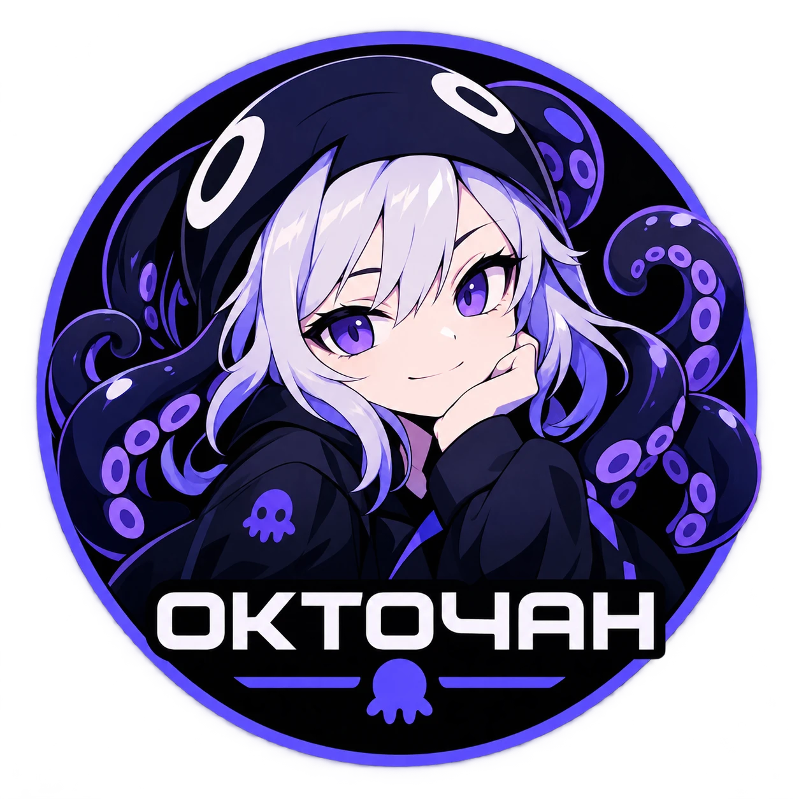

## Что такое Octochan (ochan)?

**Octochan** (команда `ochan`) — это минималистичный оркестратор для командной строки и CI/CD-систем, созданный для безопасной и предсказуемой автоматизации рутинных задач.

Главная идея проекта — **безопасность, прозрачность и контроль человека над изменениями**. Инструмент позволяет автоматизировать работу с конфигурациями, серверами и базами данных, исключая случайные ошибки благодаря предварительному планированию и системе согласования.

---

### Key Features (Ключевые возможности)

* **План до выполнения (`Plan`):** Прежде чем внести изменения, оркестратор показывает точный результат и найденные различия, ничего не перезаписывая и не ломая нативно.
* **Заявки, согласование и откат (`Approval & Rollback`):** Любые критичные операции проходят через этап подтверждения человеком. Если что-то пошло не так — изменения можно мгновенно откатить назад.
* **Безопасная интеграция с нейросетями (AI / MCP):** Содержит специальный слой для работы с ИИ. Нейросеть (LLM) может анализировать данные и формировать предложения, но **не имеет права самостоятельно исполнять команды или утверждать изменения** — окончательное решение всегда остается за человеком.
* **Ролевая модель и аудит:** Четкое разделение прав (кто и какие действия может совершать), встроенная песочница для безопасного выполнения сценариев и ведение непрерывного журнала аудита.
* **Гибкая расширяемость:** Из коробки готов к работе с файлами конфигураций и PostgreSQL, но легко адаптируется под любые задачи (Linux, Ansible, cloud-сервисы) через подключаемые модули и алиасы.
* **Поддержка CI/CD и серверного режима:** Работает как локальная утилита командной строки, в интерактивном режиме или как централизованный сервер для командной разработки.

---

### Для кого этот проект?

Octochan предназначен для **DevOps-инженеров, системных администраторов и разработчиков**, которым нужен надежный инструмент автоматизации с защитой от "человеческого фактора" и безопасными механизмами работы с ИИ-ассистентами.

Маскота зовут Тесси :3
