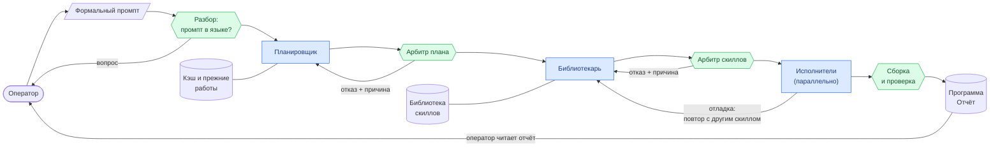
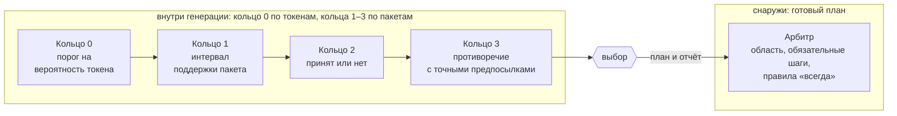

# Формальное промптирование

**Манифест**

*Андрей · версия 0.4 · октябрь 2026 · черновик для обсуждения*

> Перенесено из PDF черновика версии 0.4. Формулы набраны в LaTeX, GitHub
> отображает их как математику. Рисунок 1 и таблицы переданы таблицами,
> рисунки 2 и 3 — диаграммами Mermaid. Версия 0.3 осталась в истории git.

---

> **Аннотация.** Языковые модели уже работают исполнителями в инженерных
> системах: правят конфигурации, обслуживают базы данных, разбирают инциденты.
> Управляют ими по-прежнему текстом. Результат зависит от формулировки,
> меняется от запуска к запуску, а решения, которые модель приняла сама, никто
> не видит. Формальное промптирование (ФПм) предлагает работать с моделью как
> со слоем абстракции, у которого есть свой ограниченный язык. Оператор пишет на
> нём, что должно получиться. Модель решает, как этого добиться. Между её шагами
> и внутри генерации стоят детерминированные проверки, а всё, что модель решила
> сама, попадает в отчёт. В версии 0.4 описано, как проверки встраиваются в
> генерацию (кольца), чем недостающая предпосылка отличается от неточной и
> откуда берутся числа, по которым система выбирает между вариантами: из
> журнала решений. Текст построен вокруг одного сквозного примера, формальные
> определения вынесены в приложение. Измерений пока нет. В разделе 9 дан план
> эксперимента и названы результаты, которые опровергли бы подход.

## Содержание

1. [Зачем это нужно](#1-зачем-это-нужно)
2. [Идея на одном примере](#2-идея-на-одном-примере)
3. [Принципы](#3-принципы)
4. [Язык](#4-язык)
5. [Что решает оператор, а что модель](#5-что-решает-оператор-а-что-модель)
6. [Как система строит программу](#6-как-система-строит-программу)
7. [Журнал, калибровка и отчёт](#7-журнал-калибровка-и-отчёт)
8. [Среда разработки](#8-среда-разработки)
9. [Как это проверить](#9-как-это-проверить)
10. [Чего ФПм не обещает](#10-чего-фпм-не-обещает)
11. [Смежные работы](#11-смежные-работы)
12. [Путь внедрения](#12-путь-внедрения)
13. [Открытые вопросы](#13-открытые-вопросы)
14. [Что дальше](#14-что-дальше)
- [Список литературы](#список-литературы)
- [Приложение А. Формальная часть](#приложение-а-формальная-часть)
- [Приложение Б. Глоссарий](#приложение-б-глоссарий)

## 1. Зачем это нужно

Возьмём обычную задачу: применить новую конфигурацию nginx на десятке
серверов. Если поручить её языковой модели, задание придёт к ней текстом. Стоит
переписать его другими словами, и модель может выбрать другой порядок действий.
Запущенная дважды, она может ответить по-разному даже при нулевой температуре.
А если она решит перезапустить сервис вместо того, чтобы перечитать
конфигурацию, оператор узнает об этом по разорванным соединениям.

Это измеренные эффекты. В работе [23] одно изменение форматирования промпта
меняло точность модели LLaMA-2-13B в режиме few-shot на величину до 76
процентных пунктов. Ответы расходятся между запусками и при нулевой
температуре: численный результат на сервере зависит от того, сколько запросов
обрабатывается в одной пачке, то есть от нагрузки [15]. При смене версии модели
сильнее всего страдают промпты, в которых часть требований не высказана [28].
Когда задачу делят несколько агентов, к этому добавляются ошибки их
взаимодействия. В таксономии MAST, построенной по разметке более 1600 трасс
семи фреймворков, рассогласование агентов и недостаточная проверка результатов
составляют две из трёх групп отказов [6].

Полной детерминированности я не обещаю. Кому она нужна, тому лучше писать на
языке программирования. Цель скромнее: чтобы два прогона одной задачи с высокой
вероятностью давали один и тот же план и чтобы было видно всё, что модель
решила сама. Я исхожу из простого наблюдения. Два инженера с общими исходными
данными, общими инструментами и запретом добавлять что-то от себя чаще всего
приходят к одному выводу, нередко одной и той же дорогой. Чем уже их свобода,
тем выше эта вероятность. ФПм пытается поставить модель в такие условия: узкий
язык, явные отношения предметной области, проверка каждого шага и запрет на
молчаливые догадки.

Идея появилась у меня в конце 2024 года как замысел языка программирования, где
вместо кода пишется декларативное описание результата, а императивную часть
выполняет нейросеть. Позже стало ясно, что подход шире. Он годится для любого
промышленного применения моделей, от оркестрации инженерных задач до обмена
сообщениями между агентами и обучения узких моделей. Язык программирования
остался одним из применений.

Раздел 2 показывает идею на примере, раздел 3 формулирует принципы. Дальше идут
язык, разделение ответственности между оператором и моделью, генерация с
проверками, журнал, среда разработки и план проверки. Формальные определения и
доказательства собраны в приложении А; основной текст читается без них.

## 2. Идея на одном примере

Инженеру нужно применить новую конфигурацию nginx на узлах группы web и не
разорвать при этом активные соединения. На формальном промпте задача
записывается несколькими утверждениями, каждое в своей ячейке:

```
c1  Цель: применить конфигурацию nginx версии 42 на узлах группы web.
c2  Перед применением проверить конфигурацию на узле. Если проверка не пройдена,
    прервать.
c3  ??n_disconnect: никогда не разрывать активные соединения.
c4  Применять в нерабочее время.
```

Запись условная: синтаксис языка ещё не определён, а слова в нём будут
английскими. Ячейка c3 — жёсткое правило вида «никогда, кроме перечисленных
случаев» (раздел 4.4).

Сначала система проверяет, что каждое утверждение принадлежит языку. Вопрос
«почему у меня всё тормозит?» в языке не существует, и разбор отвергнет его, не
обращаясь к модели. Затем собирается знание о задаче: отношения из промпта и из
подключённых скиллов. Скилл инвентаря знает, какие узлы входят в группу web.
Скилл nginx знает, что перезапуск разрывает соединения, а при перечитывании
конфигурации (reload) старые рабочие процессы дообслуживают текущие соединения.

Дальше возможны три ситуации.

Допустим, группа web нигде не описана. Тогда у системы нет предпосылки, без
которой задачу не решить. Состав группы она не угадывает, а возвращает ошибку с
перечнем недостающего. Это недостающая предпосылка.

«Нерабочее время» в промпте есть, но с какого часа? Это неточная предпосылка.
Система смотрит, что известно. В пяти прошлых задачах этот оператор писал
«после 22:00 по Москве», а скилл эксплуатации по умолчанию считает нерабочим
всё, что вне 9:00–18:00. Пять совпадающих записей конкретного оператора
перевешивают общее значение по умолчанию. Система выбирает 22:00 и пишет в
отчёт выбор, альтернативу и источник. Если бы в истории поровну встречались
22:00 и 23:00, она спросила бы оператора.

Остальное — решения реализации: обходить узлы по одному или сразу, сохранять ли
прежнюю конфигурацию для отката. Здесь модель выбирает сама, и каждый выбор
попадает в отчёт.

Пока модель пишет план, каждое её утверждение проходит цепочку проверок, которые
я называю кольцами (раздел 6.2). Утверждение «перезапустить nginx на узле
web-3» хорошо согласуется с задачей: перезапуск — обычный способ применить
конфигурацию. Но вместе с правилом c3 и отношением из скилла оно даёт
противоречие, и кольцо булевой проверки отвергает его раньше, чем оно попадёт в
план. Модель пишет «перечитать конфигурацию». Готовый план проверяет арбитр: все
ли действия относятся к узлам группы web, есть ли проверка перед применением на
каждом узле. Если нет, план возвращается модели с причиной отказа.

*Таблица 1. Отчёт по задаче с nginx. Показано содержание записей, синтаксис не
определён*

| Вопрос | Выбор | Альтернативы | Основание |
|---|---|---|---|
| С какого часа «нерабочее время» | После 22:00 МСК | Вне 9:00–18:00 | История задач оператора: пять записей из пяти |
| Перезапуск или перечитывание | Перечитать конфигурацию (reload) | Перезапуск | Правило c3 и отношение скилла nginx |
| Как обходить узлы | По одному, с остановкой при первой ошибке | Все сразу; группами | Решение модели |
| Сохранять ли прежнюю конфигурацию | Сохранить копию на каждом узле | Не сохранять | Решение модели |

Вместе с планом оператор получает отчёт (табл. 1). Кроме решений, в нём есть
отказы колец. Например, пакет «перезапустить nginx на web-3» был предложен и
отвергнут, потому что противоречит c3. По отказам видно, что модель собиралась
сделать.

Оператор не читает отчёт целиком. Он смотрит записи о том, чего сам не указал.
Чем подробнее промпт, тем короче отчёт: если дописать ячейку «обходить узлы по
одному», соответствующая запись исчезнет. Этот пример проходит через весь текст.

## 3. Принципы

Девять принципов ниже — ядро ФПм. Остальной текст либо уточняет их, либо
описывает, как их выполнить.

**П1. Модель — слой абстракции, а не собеседник.** Привычная цепочка выглядит
так: пользователь, прикладное ПО, операционная система, ядро, железо. ФПм
добавляет в неё слой модели (рис. 1). Ядро не поддерживает разговор о погоде, и
модель-слой не должна. Отсюда минимальность данных: модели, которая управляет
инфраструктурой, не нужны рецепты печенья и советы, чем заняться в воскресенье.
На вход вне языка система отвечает ошибкой. Для себя я сформулировал это так:
ни при каких обстоятельствах нейросеть не должна уметь отвечать на вопрос «Как
у меня дела?».

| Привычная схема | Схема ФПм |
|---|---|
| Пользователь | Пользователь |
| Прикладное ПО | **Модель — слой ФПм** |
| Операционная система | Прикладное ПО |
| Ядро ОС | Операционная система |
| Железо | Ядро ОС |
| | Железо |

*Язык слоя — формальный промпт; вход вне языка — ошибка.*

*Рис. 1. Модель как ещё один слой абстракции между пользователем и машиной
(принцип П1).*

**П2. Конечный язык с ограниченной вариативной семантикой.** Формальный промпт
пишется на подмножестве английского с конечным словарём; английский выбран
потому, что на нём больше всего данных для обучения. У каждого слова один смысл
или несколько, условно два-три. В естественном языке у apple есть смыслы
«фрукт», «компания», «библейский образ» и другие, в формальном промпте их,
скажем, два. Какой из них имеется в виду, решает контекст: соседние объекты и
их классы.

**П3. Обобщения и частные случаи.** Слова и сочетания языка — обобщения со
слотами: «узел», «группа узлов», «применить конфигурацию к группе». Частные
случаи — то, что подставляет оператор: web, версия 42. Модели не нужно
восстанавливать смысл всего текста: она распознаёт обобщение и подставляет
значения. В обучающих данных понятие задаётся один раз, дальше идут его
экземпляры с меткой обобщения.

**П4. Классы обобщения и одноимённость.** Одно слово может относиться к разным
классам. «Бензин» как топливо и «бензин, разлитый на дороге» — одноимённые
объекты в смысле Аристотеля [1]: имя одно, категории разные. В задаче с nginx
web — имя группы узлов, в другой задаче это может быть имя сервиса. Класс
определяет, какую часть программы затрагивает утверждение.

**П5. «Что» задаёт оператор, «как» строит модель.** Программист, получивший
задание от нефтеперерабатывающего завода, не обязан разбираться в крекинге:
отношения предметной области он берёт из задания, реализацию — из своего
ремесла. С моделью так же. Отношения ей дают промпт и скиллы, сама она строит
только реализацию. Недостающую предпосылку она не придумывает. Неточную может
сузить, но только по явным источникам и с записью в отчёт, а при сопоставимых
вариантах спрашивает оператора (раздел 5.2).

**П6. Нейросеть предлагает, алгоритм разрешает.** Результат модели не проходит
дальше без детерминированной проверки. Проверки стоят между шагами конвейера и
внутри генерации, где утверждение не попадает в план, пока не пройдёт кольца
(раздел 6.2). Если модель запросила для задачи веб-дизайна скилл серверной
разработки, алгоритм отказывает и называет причину.

**П7. Подотчётность.** Всё, что повлияло на результат и не было сказано
оператором, попадает в отчёт: выбор, альтернативы, основание, источник. Отчёт
пишется на том же формальном языке, перевод на естественный — подключаемый
скилл. Отчёты вместе с вердиктами проверок образуют журнал, из которого система
берёт свои числа (раздел 7).

**П8. Локальность правок и приоритет человека.** Правка, которая касается
одного класса, меняет его код и то, что от него зависит, и больше ничего.
Человек может править сгенерированный код, и его правки защищены: для языка
пользователь всегда прав.

**П9. Один протокол.** Тот же язык — единственный язык обмена между агентами.
Смысл сообщения фиксирует язык, и получателю нечего толковать по-своему.
Формальное утверждение агента («тест T пройден») можно проверить до того, как
его примет следующий.

## 4. Язык

### 4.1. Откуда берутся расхождения

Между тем, что хотел оператор, и тем, что поняла система, бывает расхождение
трёх видов (табл. 2). Лексическая неоднозначность: у слова несколько смыслов.
Структурная: слова однозначны, но сочетание допускает два разбора.
Недоопределённость: о чём-то не сказано вообще. Ограниченный словарь помогает
только против первой. Против второй работает грамматика, которая запрещает
двусмысленные конструкции или фиксирует их чтение. Против третьей — разделение
«что» и «как» с отчётом (раздел 5). Третья опаснее остальных: модели сами
угадывают невысказанные требования примерно в 41 % случаев, но промпты с
невысказанными требованиями примерно вдвое чаще деградируют при смене модели
или формулировки [28].

*Таблица 2. Три вида расхождения между замыслом оператора и тем, что поняла
система*

| Вид | Пример | Что делает ФПм |
|---|---|---|
| Лексическая неоднозначность | «Проверка»: синтаксиса файла (`nginx -t`) или доступности сайта после применения? | Конечный словарь, мало смыслов у слова, выбор смысла по классам соседних объектов |
| Структурная неоднозначность | «Все узлы, кроме резервных в зоне b»: зона относится ко всем исключаемым узлам или только к резервным? | Грамматика с фиксированной областью действия |
| Недоопределённость | «Применять в нерабочее время»: с какого часа? «Применить на группе»: по одному или сразу? | Недостающая предпосылка — ошибка; неточная — сужение с отчётом или вопрос; решение реализации — запись в отчёте |

### 4.2. Почему ограниченный словарь помогает

Пусть грамматика фиксирует структуру утверждения, а у каждого из $n$
знаменательных слов не больше $k$ смыслов. Тогда разброс возможных прочтений
ограничен сверху величиной $n \log_2 k$ бит (приложение А.1), а если контекст
оставляет одно прочтение, разброса нет совсем. Для естественного языка такой
оценки нет: ни словарь, ни число смыслов слова не ограничены. При этом оценка
ничего не говорит о недоопределённости. Фраза «отсортировать пользователей по
имени» читается однозначно и всё равно не говорит, учитывать ли регистр, куда
ставить «ё» и что делать с пустыми именами.

Язык сознательно допускает несколько способов записать одно и то же: это цена
близости к естественному языку. Разные записи различаются силой. Я исхожу из
того, что стройная однозначная запись даёт лучший результат: планировщик меньше
ошибается при разборе, библиотекарь точнее подбирает скиллы. Чтобы этот тезис
можно было проверить, сила записи измеряется по поведению модели, через
согласованность и правильность прогонов (раздел 9).

### 4.3. Обобщения и проверка выученного

Обучение на обобщениях несёт риск: модель может выучить не понятие «сервер», а
шаблон имени «server и число». Если в данных есть только server1, server2 и так
далее с меткой «сервер», обе гипотезы безошибочны на обучении. Различить их
могут только примеры, на которых они расходятся: сервер с именем вне шаблона и
не-сервер с именем по шаблону (табл. 3). В данных нужны обе половины. Первые
отсекают гипотезы уже понятия, вторые — шире.

Проверка идёт на отложенных примерах такого рода. Ответ модели не должен
меняться, когда меняется только имя объекта, и должен меняться, когда меняется
только его роль. Незнакомый cache-02 в роли сервера шаблон назовёт «не сервер»,
а выученное понятие — «сервер». Критерий опровергает названных соперников
понятия, но не доказывает понятие «вообще». Поэтому перечень соперников
хранится вместе с обобщением, как тесты хранятся вместе с кодом
(приложение А.6).

*Таблица 3. Примеры, которые различают понятие «сервер» и шаблон имени*

| Вид примеров | Примеры | Что отсекают |
|---|---|---|
| Имя вне шаблона, объект — сервер | db-main, web-prod-01, k8s-node-a, mail.example.com | Гипотезы уже понятия, в том числе сам шаблон |
| Имя по шаблону, объект — не сервер | server7 в названии стойки, server1 как имя контейнера, server2 как имя переменной | Гипотезы, принимающие всё с именем по шаблону |
| Одно имя, разные роли | server1 в инвентаре Ansible и в журнале | Жёсткую связь имени с классом (П4) |

### 4.4. Жёсткие правила

Некоторые ограничения нельзя нарушать ни при каких обстоятельствах, кроме явно
перечисленных. Для них в языке есть маркер «??». Он выбран вместо «!», который в
языках семейства C означает отрицание: запись `!n_disconnect` читалась бы
двояко. Синтаксис пока набросок:

- `??n_X(x1, …, xn)` — «никогда X, кроме случаев x1, …, xn»;
- `??a_X(…)` — «всегда X» на объявленной области.

Исключения — слоты, как у обобщений. Именованную привязку `x1={…}` объявляют
один раз и затем используют в других правилах по имени.

Правило работает в два шага. Сначала оно входит в контекст генерации, и модель
реже его нарушает. Затем разбор компилирует его в проверку. Правила «никогда»
проверяет уже кольцо 3, прямо во время генерации: нарушение видно, как только
появилось утверждение. Правила «всегда» проверяет только арбитр, потому что их
нарушение — отсутствие чего-то, и видно оно лишь в готовом плане. Арбитр
повторно проверяет и правила «никогда», уже по плану целиком. В проверку
правило компилирует разбор. Если бы это делала модель, проверка снова стала бы
вероятностной. И всё это происходит до исполнения: проверка после того, как
команда ушла на серверы, даёт запись в журнале, но не защиту.

На маркер наложены три ограничения.

- **(Ж1)** «??» ставится только на то, что проверяется по плану. Нагрузка,
  задержки и другие свойства исполнения записываются без «??» и помечаются в
  отчёте как проверяемые тестами и мониторингом. Тогда «??» всегда означает
  гарантию.
- **(Ж2)** Исключения записываются на том же строгом языке, что и само правило.
  Иначе модель сама решит, когда исключение сработало, и правило станет мягким
  через исключение.
- **(Ж3)** Два жёстких правила могут противоречить друг другу: «не разрывать
  соединения» и «применить немедленно», если применение требует перезапуска.
  Приоритета между абсолютными правилами нет, поэтому такой конфликт — ошибка
  до исполнения.

Размытое пожелание вроде «код без уязвимостей» жёстким правилом не записать:
такого сочетания нет в словаре, и разбор его отвергнет. Чтобы получить такое
свойство, оператор расписывает его через проверяемые отношения.

## 5. Что решает оператор, а что модель

### 5.1. Реализации, недоопределённость и отчёт

Знание о задаче — это отношения из промпта и подключённых скиллов. Реализаций,
которые им удовлетворяют, обычно много. Назовём наблюдаемым вопросом видимый
пользователю аспект поведения: в каком порядке обходить узлы, что делать при
ошибке на третьем узле, сохранять ли копию. Вопрос недоопределён, если разные
допустимые реализации отвечают на него по-разному. Такие вопросы модель решает
сама, и они попадают в отчёт.

Чем больше оператор написал, тем меньше допустимых реализаций и тем короче
отчёт. Доказательство занимает две строки (приложение А.2), а следствие
практическое: детализация работает как ползунок. Нижняя граница — всё, без чего
задачу нельзя решить; ниже неё система выдаёт ошибку. Верхняя — все наблюдаемые
вопросы закрыты и отчёт пуст; это код, записанный в более читаемой форме.
Оператор выбирает точку между границами и уточняет там, где ему важно.

Декларативные системы давно отдают машине выбор «как». Оптимизатор СУБД
выбирает план запроса [24], и для запроса с однозначно определённым результатом
любой план вернёт те же строки. Это случай пустого отчёта. ФПм распространяет
такой подход на задачи, где выбор машины виден пользователю, и возмещает это
отчётом.

### 5.2. Недостающие и неточные предпосылки

Недостающая предпосылка — та, которой нет нигде: ни в промпте, ни в скиллах, ни
в истории задач. Неточная есть, но размыта: «в нерабочее время», «с узлом
что-то не так». Система обращается с ними по-разному.

Недостающую предпосылку модель не восполняет. Система возвращает ошибку с
перечнем недостающего, и вопрос уходит оператору.

Неточную предпосылку модель может сузить. Сначала она смотрит контекст ячейки,
затем историю прошлых промптов, затем скиллы, собирает варианты прочтения и
оценивает, насколько каждый поддержан (как именно, описано в разделе 6.2).
Дальше возможны три исхода:

- нижняя граница поддержки лидера выше верхних границ остальных вариантов:
  модель принимает лидера и пишет в отчёт выбор, альтернативы и источник;
- интервалы поддержки лидера и следующего варианта пересекаются, то есть
  варианты сопоставимы: система спрашивает оператора;
- в ячейках, связанных с предпосылкой, высока недоопределённость: система
  спрашивает, даже если один вариант лидирует.

Третье правило не даёт строить уверенное сужение на шатком основании.
Недоопределённость считается не по всей программе, а по связанным ячейкам:
сначала по общим понятиям, затем по зависимостям этих ячеек (раздел 8.2,
приложение А.2). Неясность в одном углу программы не должна заставлять
спрашивать о другом.

Источник, у которого нет ни одного общего понятия с остальными, получает
нулевой вес. Чаще всего это правильно: если в записи из истории нет ни узла, ни
группы, ни времени, нет и оснований считать, что она про эту задачу. Но разрыв
может означать и то, что не хватает связующей предпосылки. Различает эти
случаи тот же критерий. При высокой недоопределённости связанных ячеек система
спрашивает, при низкой работает с нулевым весом и записывает отброшенный
источник в отчёт.

В версии 0.3 любое отсутствие отношения считалось ошибкой. Это честно, но
система превращается в ребёнка, который бегает к оператору с каждой мелочью.
Теперь ошибкой остаётся то, чего нет совсем, а неточное разрешено сужать
открыто.

### 5.3. Граница с вайбкодингом

Вайбкодингом с подачи A. Karpathy [17] называют разработку, при которой человек
описывает желаемое как угодно и принимает код, не вникая в него. Раз в ФПм
теперь разрешено сужать неточные предпосылки, границу нужно провести заново.
Вайбкодинг позволяет модели молча придумывать «что», в том числе то, о чём
оператор не сказал ни слова. ФПм не позволяет придумывать недостающее,
разрешает сужать неточное только по явным источникам и требует записать каждое
сужение. Сужение без источника — догадка, и система её не делает.

Можно возразить, что при скупом промпте ФПм превращается в тот же вайбкодинг с
ограниченным словарём. Этого не происходит, потому что у ползунка детализации
есть нижняя граница: если не хватает того, без чего задачу не решить, система
выдаёт ошибку.

## 6. Как система строит программу

### 6.1. Конвейер

Сборка идёт по шагам, и после каждого нейросетевого шага стоит
детерминированный арбитр (рис. 2). Разбор проверяет, что промпт принадлежит
языку. Планировщик выделяет обобщения, частные случаи и классы и ищет в кэше
готовые части. Арбитр плана проверяет, что каждое отношение, на которое
опирается план, есть в знании о задаче. Библиотекарь подбирает скиллы, арбитр
скиллов проверяет, что они существуют и подходят задаче. Исполнители пишут код
по частям параллельно, а последний шаг собирает части, запускает тесты и сверяет
результат со спецификацией.



*Рис. 2. Конвейер сборки. Синие — нейросетевые шаги, зелёные —
детерминированные, цилиндры — данные и хранилища. После каждого нейросетевого
шага стоит арбитр, внутри шага работают кольца (рис. 3). Отказ возвращается с
причиной, нерешаемое уходит оператору вопросом.*

Арбитры не вычисляют вероятностей: все их проверки сводятся к поиску по таблицам
и сравнению множеств. Совместимость скиллов считается по классам, явно
объявленным в промпте. Сайт с формой обратной связи законно получает серверный
скилл, а сайт без формы его не получает. Таблица «какой класс требует какого»
входит в библиотеку скиллов.

Скиллы распространяются как библиотеки языка программирования. Базовая модель
знает язык и приёмы реализации, знания предметной области приходят из скиллов,
и модель видит только то, что загружено для задачи. С квантованием такая модель
работает автономно и локально, как обычный компилятор. Для узких повторяющихся
задач агентных систем малые модели достаточны и заметно дешевле [3].

Исполнители делят работу по файлам или модулям с интерфейсами, которые
зафиксировал планировщик; резать программу по диапазонам строк нельзя. Кэш
отдаёт сохранённый результат для того же промпта при той же конфигурации.
Искать готовые части разумно только среди зарегистрированных проверенных
артефактов с версиями, иначе сборка зависит от того, какие файлы случайно лежат
на диске. Сходство при поиске считается по структуре задачи. По тексту его
считать нельзя: промпты «по возрастанию» и «по убыванию» почти совпадают как
тексты и противоположны по смыслу.

### 6.2. Кольца

Внутри каждого нейросетевого шага модель генерирует текст, и здесь работают
кольца. Модель выдаёт вероятности, а формальные проверки отвечают «да» или
«нет». Кольца — цепочка фильтров между тем и другим (рис. 3). Каждое следующее
кольцо пройти труднее, и то, что не прошло, дальше не участвует. Кольца 0–3
работают внутри генерации, между вычислением следующего фрагмента и его записью
в ответ. Арбитр — внешнее кольцо: он видит только готовый план.



*Рис. 3. Кольца, условная схема. Кандидаты отсеиваются по мере прохождения
колец, среди прошедших кольцо 3 выбирает правило, готовый план проверяет
арбитр. Отказы всех колец пишутся в журнал.*

Это новая и наименее проработанная часть ФПм. Ниже описано то, что решено;
открытые места отмечены.

**Кольцо 0: порог на вероятность токена.** На каждом шаге модель даёт
распределение вероятностей следующего токена. Кольцо 0 пропускает только токены
с вероятностью не ниже порога $\tau$ из конфигурации.

Высоким этот порог быть не может. Вероятности в одной позиции в сумме дают
единицу, поэтому порог $\tau$ пропускает не больше $\lfloor 1/\tau \rfloor$
кандидатов: при $\tau = 0{,}8$ одного, при $\tau = 0{,}1$ десять. Вероятность
0,8 у реальных моделей встречается редко, так что рабочий порог будет низким, а
кольцо — широким.

Если в позиции порог не прошёл ни один токен, генерировать эту позицию заново
бесполезно. При том же тексте модель даёт то же распределение. Разные ответы при
повторном запуске получаются из-за случайного выбора токена, а вероятности
остаются прежними, с точностью до мелкого численного шума [15]. Поэтому
генерация откатывается к началу текущего утверждения. Повторный провал
считается сигналом недоопределённости, и дальше действует правило из
раздела 5.2.

Кольцо 0 требует доступа к распределению. Модели, доступные только через API,
его обычно не отдают, и для них кольца 0 нет (раздел 6.4).

**Пакеты.** Кольца 1–3 работают с пакетами. Пакет — законченное
утверждение-кандидат на формальном языке. Модель предлагает несколько
продолжений с общим, уже записанным началом, например

$$
a_0 = \lbrace \text{узел web-3},\ \text{перезапустить nginx} \rbrace, \qquad
a_1 = \lbrace \text{узел web-3},\ \text{перечитать конфигурацию nginx} \rbrace,
$$

и кольца оценивают каждое целиком. Отдельный токен «перезапустить» не истинен и
не ложен, а утверждение «перезапустить nginx на узле web-3» уже можно проверить.
Часть пакета модель может взять из утверждённых предпосылок: имя узла в задаче
уже есть, генерировать его заново не нужно. Токены пакета записываются в ответ,
только когда выбор сделан.

**Кольцо 1: интервал поддержки.** Кольцо 1 — логика с выводами и интервалами.
Для каждого пакета оно выводит из предпосылок и правил интервал поддержки и само
объясняет его: «перечитать конфигурацию на web-3: поддержка 0,86–0,93 по
правилу r1». Самые бессмысленные пакеты отсекаются уже здесь. Сама модель
дедукции не делает, она прогоняет через себя весь контекст. Кольцо даёт ей
внешнюю опору, подобие дедукции.

Правила вывода приходят из скиллов, например «изменение конфигурации
применяется перечитыванием или перезапуском». Через правило в пакет попадает
понятие, которого в предпосылках нет, например новое действие. Надёжность
правила — доля планов, где оно использовалось и прошло без правок; по журналу
для неё считается 95-процентный интервал. Правило, применённое 300 раз с 270
успехами, получает 0,86–0,93, применённое трижды с тремя успехами — 0,40–0,99
(приложение А.7).

Предпосылки считаются независимыми. Поэтому поддержки посылок правила
перемножаются, а поддержка вывода равна надёжности правила, умноженной на
поддержку посылок. Ширина интервала при этом берётся из объёма журнала: чем чаще
правило проверено, тем интервал уже.

Независимыми считаются разные источники и разные правила. Записи истории одного
оператора — один источник, его привычка, и считаются они вместе, через
счётчики. Если пакет выводится несколькими независимыми путями, их поддержки
складываются: пути 0,7 и 0,6 дают $1 - 0{,}3 \cdot 0{,}4 = 0{,}88$. Для путей с
общими посылками нижней границей служит только максимум, 0,7.

Кроме выводов, кольцо смотрит, насколько понятия пакета привязаны к
предпосылкам. По предпосылкам строится граф совместной встречаемости: понятия —
вершины, два понятия связаны, если встречаются в одной предпосылке. Вес понятия
— его компонента в главном собственном векторе матрицы этого графа
(приложение А.7). Чем больше понятие связано с остальными, тем больше вес. В
задаче с nginx больше всех весят «узел» и «группа web»: на них опираются почти
все утверждения. Близость разных понятий («перечитать» и reload) задаёт
отдельная таблица близости.

Здесь две оговорки. Первая: связи не равны важности. Правило «не разрывать
соединения» опирается на одно-два понятия и получит малый вес, хотя нарушить его
дороже всего. Поэтому жёсткие правила идут мимо весов, прямо в кольцо 3. Вторая:
если граф распадается на несвязанные части, главный собственный вектор обнуляет
все части, кроме одной. Это и есть источник без общих понятий из раздела 5.2.

Наконец, интервал поддержки собран из частот журнала, но при допущении
независимости, которое выполняется не всегда. Поэтому итоговая оценка пакета ещё
раз калибруется по журналу (раздел 7).

**Кольцо 2: принят или нет.** Кольцо 2 сравнивает нижнюю границу интервала
поддержки с порогом и переводит её в решение: пакет принят или не принят.
Правило, проверенное мало раз, даёт широкий интервал с низкой нижней границей и
порог не проходит. Так само собой работает «кандидат до подтверждения» из
раздела 7.

Для колец «ложь» и «не принят» означают одно и то же: пакет отбрасывается
целиком. Дальше он не участвует ни сам, ни в виде отрицания, а причина отказа
уходит в журнал. Это правило вынужденное: порог не согласован с отрицанием ни
при каком значении (приложение А.7). Если бы отвергнутый пакет шёл в кольцо 3
как отрицание, кольцо 3 выводило бы то, чего кольцо 1 не поддерживает.

**Кольцо 3: булева проверка.** Кольцо 3 проверяет принятый пакет на
противоречие с точными предпосылками. Точные предпосылки — это определения
(«web-3 — узел группы web»), отношения, заданные оператором, правила «никогда»,
точные части неточных предпосылок и уже принятые пакеты. Неточную предпосылку
можно разложить: в «с узлом web-3 что-то не так» точно известно, о каком узле
речь и что что-то происходит. В булеву проверку идут только такие части.
Догадки, даже уверенные, туда не попадают.

Это кольцо ловит ошибки, прошедшие оценку поддержки. Пакет «перезапустить nginx
на web-3» поддержан хорошо, потому что перезапуск — обычный способ применить
конфигурацию. Но вместе с правилом c3 и отношением скилла «перезапуск разрывает
соединения» он даёт противоречие, и кольцо 3 его отвергает.

**Принятые пакеты.** Принятый пакет становится предпосылкой для следующих,
причём с единицей, как установленный факт. Поэтому поддержка каждого следующего
шага считается при условии, что предыдущие верны, а кольцо 3 сразу ловит
противоречие внутри плана: «перезапустить» на седьмом шаге после «соединения
сохраняем» на третьем. Если бы принятые пакеты входили со своей поддержкой, она
таяла бы по цепочке (0,9, затем 0,81, затем 0,73), и длинный план не собрался
бы.

Потеря уверенности при этом никуда не девается: поддержка плана равна
произведению поддержек его шагов (приложение А.7). Двадцать шагов по 0,97 дают
около 0,54. Что делать, когда каждый шаг прошёл, а план в целом поддержан
слабо, пока не решено.

**Выбор.** Если кольца прошли несколько пакетов, выбор делает правило, и модель
в нём не участвует. Правило — взвешенная сумма четырёх величин: средней
логарифмической вероятности токенов пакета (кольцо 0), нижней границы и ширины
интервала поддержки (кольцо 1) и привязки понятий пакета к предпосылкам
(приложение А.7). Веса определяет калибровка по журналу, а пока журнал мал, их
задаёт автор скилла; заранее ни одному кольцу приоритет не даётся. Если лучший и
второй пакеты почти равны, разрыв между ними записывается в журнал.

### 6.3. Арбитр и бюджеты

Арбитр видит только готовый план и проверяет достаточные условия допуска: все ли
действия относятся к объявленной области, выполнены ли обязательные шаги,
соблюдены ли правила «всегда» и, повторно, правила «никогда». При отказе он
называет причину на формальном языке, например «действие на узле db-1 вне
группы web», и план возвращается модели. Хорошая проверка зрелости системы:
может ли арбитр объяснить любой свой отказ одной такой фразой.

Чтобы проверки не зациклили генерацию, у них есть бюджеты в конфигурации. На
утверждение даётся $N$ попыток, и пакет, отвергнутый один раз, больше не
предлагается. На план даётся $M$ отказов арбитра. Если арбитр дважды отказал по
одной и той же причине, модель исправить это не может, и система вместо
следующей попытки спрашивает оператора.

### 6.4. Встроенный режим и режим протокола

Кольца 0–3 встраиваются в генерацию, только если система управляет моделью:
видит распределение вероятностей и может придержать токен. Так можно работать с
локальной моделью. С моделью, доступной через API, система получает готовый
ответ, и кольца работают как протокол: кольца 0 нет, кольца 1–3 применяются к
утверждениям готового ответа, арбитр работает как обычно. Гарантии в двух
режимах разные. Во встроенном режиме отвергнутое утверждение не появляется в
ответе. В режиме протокола оно появляется, но дальше не проходит. Отчёт
указывает, в каком режиме работала система, чтобы оператор не ждал от второго
режима гарантий первого.

### 6.5. Чего кольца не ловят

Кольца отсекают формально неверное. Пусть оператор ничего не сказал о
соединениях, а скилл не связывает перезапуск с их разрывом. Тогда оба пакета,
«перезапустить» и «перечитать», формально верны, и выбор между ними — решение
модели в области «как». Ни одно кольцо его не поймает. Поэтому в отчёт идут все
решения модели, включая уверенные, и все отказы колец. Модель, которая уверенно
выбрала не то, ни о чём не спросит, и увидеть такой выбор можно только в отчёте.

## 7. Журнал, калибровка и отчёт

В кольцах много порогов и весов, и систему легко превратить в набор чисел,
подобранных на глаз. Чтобы этого не случилось, все числа берутся из одного
источника — журнала решений. Журнал составляют отчёты по всем задачам вместе с
вердиктами: что арбитр пропустил и что отверг, что оператор принял, а что
исправил.

### 7.1. Правила и их надёжность

Автор скилла пишет правила вывода без чисел. Надёжность правила — доля планов,
где оно использовалось и которые прошли арбитра и не были исправлены
оператором; по журналу для неё считается интервал (раздел 6.2). Модель может
предлагать новые правила, но они хранятся как кандидаты и попадают в скилл
только после подтверждения. Пока кандидат мало проверен, его интервал широк, и
пакеты с ним не проходят кольцо 2. Это принцип П6, применённый к самим правилам.

### 7.2. Калибровка

Интервал кольца 1 собран из частот журнала, но при допущении независимости,
которое выполняется не всегда. Поэтому итоговая оценка пакета из правила выбора
калибруется отдельно. Берутся все пакеты с оценкой, скажем, от 0,7 до 0,8, и по
журналу считается, какая доля из них оказалась верной, то есть прошла арбитра и
не была исправлена. Если доля около 75 %, шкала откалибрована. Если нет,
поправка «оценка → наблюдаемая доля» её исправляет. По тому же журналу
подбираются веса в правиле выбора.

### 7.3. Слепая калибровка

Калибровка честна, только если исход не зависит от самой оценки. Вердикты
арбитра этому условию удовлетворяют: арбитр детерминирован и оценок не видит. С
оператором сложнее. Увидев в отчёте «0,9», он охотнее согласится, и калибровка
начнёт подтверждать сама себя. Поэтому по умолчанию оценки колец оператору не
показываются. Показ включается параметром конфигурации, и при включении система
предупреждает, что решения этого оператора перестают быть слепыми для
калибровки.

### 7.4. Что попадает в отчёт

Правило одно: всё, что повлияло на план, но не было сказано оператором.
Конкретно:

- суженные неточные предпосылки, с вариантами и источником;
- источники и предпосылки, получившие нулевой вес;
- решения модели в области «как», с разрывом между лучшим и вторым вариантом;
- отказы колец: сколько и по каким причинам;
- отказы арбитра с причинами.

Числа, включая интервалы и разрыв между вариантами, хранятся в журнале. По
умолчанию оператор видит выбор, альтернативы, источник и правила, по которым
выведен выбор («по правилам r1 и r3»), а интервалы — только при включённом
показе. Как показать ему, что варианты были близки, не нарушив слепоту
калибровки, — открытый вопрос.

Отчёт пишется на формальном языке, поэтому любое решение из него можно
перенести в промпт новой ячейкой, и оно перестанет быть решением модели. Читать
отчёт оператор учится так же, как администратор учится читать журналы, а
администратор баз данных — план запроса (EXPLAIN). Целиком его никто не читает:
оператор идёт к тому, чего сам не указал.

### 7.5. Холодный старт и риски

У нового скилла журнала нет. Без поправки каждое правило проходило бы кольцо 2
только после долгой проверки, и система спрашивала бы оператора на каждом шаге.
Поэтому автор скилла задаёт правилу условный счёт, например «как будто 8 раз
сработало и ни разу не подвело». Это даёт стартовый интервал 0,66–1,00, дальше
его сдвигает журнал. Сколько условных применений давать и как быстро их
вытеснять, пока не решено. Второй риск в том, что система учится и на ошибках
оператора: если он принял плохой план, правила этого плана станут считаться
надёжнее. Как исправлять такие записи задним числом, например после отката или
инцидента, — тоже открытый вопрос.

## 8. Среда разработки

### 8.1. Ячейки и правки

Систему не создают одним промптом. Разработка идёт как по техническому заданию:
скелет, затем требования, затем уточнения. Среда устроена как ноутбук наподобие
Jupyter, только в ячейках формальные промпты. Каждый участок промпта привязан к
коду, который он породил: выделив участок, оператор видит этот код, и наоборот.

Состояние программы определяется текущим списком ячеек и не зависит от того, в
каком порядке их запускали раньше. Удалить ячейку — значит откатить её правку.
Для обычных ноутбуков зависимость от истории запусков — известная беда. В
исследовании 1,4 млн ноутбуков с GitHub из примерно 864 тыс., которые пытались
перезапустить, без ошибок выполнились около 24 %, а сохранённые результаты
воспроизвели около 4 % [21]. В ФПм скрытого состояния нет по построению. Ячейки
задают значения («не больше четырёх рабочих процессов»), приращений вроде
«добавить ещё два» в них нет. Поэтому повторное выполнение ячейки ничего не
меняет.

*Таблица 4. Зависимости ячеек задачи с nginx при удалении c2*

| Ячейка | Добавляет | Ссылается на | Зависит от c2 |
|---|---|---|---|
| c1 Применить конфигурацию v42 на группе web | Цель, конфигурацию v42, область | — | Нет |
| c2 Проверить конфигурацию перед применением, при ошибке прервать | Шаг проверки, результат проверки | Конфигурацию v42 | Удаляется |
| c3 Никогда не разрывать активные соединения | Правило о соединениях | — | Нет |
| c4 Применять в нерабочее время | Окно применения | Цель | Нет |
| c5 Если проверка не пройдена, оповестить дежурного | Оповещение | Результат проверки | Да |

### 8.2. Зависимости

Когда ячейка меняется или удаляется, нужно знать, какие ячейки от неё зависят.
Первая мысль — считать зависимыми ячейки о близких понятиях. Работает она плохо:
в задаче с nginx почти все ячейки так или иначе говорят о конфигурации, и
зависимыми оказываются все. Поэтому зависимость определяется по чтению и записи.
Ячейка зависит от другой, если ссылается на то, что та добавила или изменила,
напрямую или через цепочку таких ссылок. В формальном языке ссылки явные, и их
находит разбор без участия модели.

Пусть оператор добавил ячейку c5: «если проверка на узле не пройдена, оповестить
дежурного». Она ссылается на результат проверки, который вводит c2. Удаление c2
затрагивает только c5 (табл. 4). Расстояние между понятиями при этом остаётся
нужным для другой цели: проверки того, что изменения кода после правки не
выходят за окрестность затронутых классов (принцип П8, приложение А.8).

### 8.3. Уровни согласованности

Если от удаляемой ячейки кто-то зависит, у системы есть выбор: попытаться
согласовать зависимые ячейки с новым состоянием или остановиться и спросить. По
аналогии с уровнями изоляции транзакций в СУБД [4] ФПм вводит уровни
согласованности (табл. 5). Нестрогий уровень остаётся прозрачным, потому что
каждое согласование попадает в отчёт.

*Таблица 5. Уровни согласованности: что происходит при удалении ячейки, от
которой зависят другие*

| Уровень | Поведение | Гарантии |
|---|---|---|
| Согласование | Система пытается согласовать зависимые ячейки с новым состоянием | Результат не гарантирован; каждое согласование — запись в отчёте |
| Строгий | Ошибка с перечнем зависимых ячеек; решает оператор | Несогласованное состояние невозможно |
| Промежуточные | Например, согласование внутри одного класса и ошибка при зависимостях между классами | Задаются в конфигурации |

### 8.4. Что делает новая ячейка

Новая ячейка добавляет к знанию задачи отношение. Если знание непротиворечиво,
возможны ровно три случая (приложение А.4).

- **Конфликт:** отношение противоречит знанию. «Перезапустить nginx после
  применения» несовместимо с c3 и отношением скилла. Сообщение об ошибке
  называет новую ячейку и те, с которыми она несовместна; кто прав, решает
  оператор.
- **Повтор:** отношение уже следует из знания. Правка ничего не меняет.
- **Уточнение:** отношение новое и непротиворечивое, например «обходить узлы по
  одному». Отчёт от него только короче.

Чтобы арбитр различал эти случаи детерминированно, отношения должны записываться
во фрагменте логики, где выводимость разрешима, а знание должно быть
непротиворечиво. На строгом уровне согласованности это гарантировано, на
нестрогом нет.

### 8.5. Ручные правки

Оператор может править сгенерированный код напрямую. Такие фрагменты
помечаются флагом оператора и защищены: для языка пользователь всегда прав, даже
если ошибается. Если пересборка затрагивает помеченный фрагмент, система не
решает сама, а спрашивает, затереть ли правку. Ответ оператора — тоже ручная
правка, так что принцип соблюдается без исключений. Модель может предложить
исправление, но не применить его.

## 9. Как это проверить

### 9.1. Что измерять

Главная величина — согласованность: доля пар прогонов одной записи задачи,
давших одинаковый план. Вторая — правильность: доля прогонов, давших задуманный
план. Для $N$ прогонов с планами $I_1, \dots, I_N$ и задуманным планом $I^*$

$$
\hat c = \binom{N}{2}^{-1} \sum_{a<b} \mathbf{1}\bigl[I_a \approx I_b\bigr],
\qquad
\hat p = \frac{1}{N} \sum_{a=1}^{N} \mathbf{1}\bigl[I_a \approx I^*\bigr].
$$

Это разные вещи. Задачу, которую модель стабильно понимает неверно,
согласованность оценит высоко, а правильность низко.

Сравниваются планы. Два разных текста могут описывать один план, поэтому план
представляется набором ответов на наблюдаемые вопросы (способ применения,
порядок обхода, откат), и знак $\approx$ означает, что ответы совпали. Для
частичного совпадения есть мера: взвешенная доля расходящихся ответов, то есть
взвешенное расстояние Жаккара (приложение А.5). Веса вопросов фиксируются до
замера и берутся из графа предметной области, который поставляет скилл:
перепутанный порядок обхода стоит меньше, чем разорванные соединения. Нарушение
жёсткого правила засчитывается как ошибка независимо от остального.

Зачем нужны проверки на каждом шаге, видно из простой оценки. Пусть на каждом
шаге два прогона совпадают с вероятностью $a$ при условии, что совпали все
предыдущие шаги. Тогда план из $n$ шагов совпадёт целиком с вероятностью $a^n$
(приложение А.7). При $a = 0{,}95$ и $n = 100$ это около 0,6 %, при
$a = 0{,}99$ — около 37 %. Небольшой выигрыш на шаге даёт большой выигрыш на
плане. Та же оценка объясняет, почему расхождение между прогонами растёт с
длиной ответа даже на конечном языке.

### 9.2. Эксперимент

Первый эксперимент ставится на уровне протокола. Берётся около 50 типовых задач
эксплуатации: СУБД, nginx, Kubernetes, Docker, Linux. Для каждой готовятся
несколько перефразировок на естественном языке и несколько записей на
формальном, и каждая запускается несколько раз. Сравниваются четыре условия:

1. естественный язык;
2. формальный промпт с разбором, арбитрами и отчётом, без колец;
3. то же с кольцами 1–3 в режиме протокола;
4. встроенный режим со всеми кольцами на локальной модели.

В условиях 1–3 модель одна и та же. Разница между первым и вторым условием
показывает вклад языка и арбитров, между вторым и третьим — вклад колец. Вклад
каждого кольца меряется отдельно: одно убирают, остальные оставляют.

Измеряются согласованность на одной записи и между перефразировками,
правильность, доля неверных или запрещённых действий и доля ошибок, которые не
поймал ни один механизм и которых нет в отчёте. Кроме того, меряются полнота
отчёта по экспертной разметке, ложные отказы колец (отвергнутые верные пакеты),
число перегенераций и вопросов оператору на задачу, токены и время, доля задач,
план которых изменился при смене версии модели, и откалиброванность оценок.

Гипотезы, правила разметки и параметры фиксируются до эксперимента. Разметка
слепая: разметчик не знает, из какого условия план, а согласие разметчиков
оценивается отдельно [19]. Порядок сравнений важнее абсолютных значений.
Проверяются гипотезы:

- **(H1)** согласованность перефразировок у формального промпта выше, чем у
  естественного языка;
- **(H2)** ошибок меньше, и большая часть оставшихся поймана арбитрами или видна
  в отчёте;
- **(H3)** при недостающей предпосылке формальный промпт даёт ошибку, а не
  догадку;
- **(H4)** при смене версии модели планы формального промпта меняются реже; для
  сравнения, недоопределённые промпты деградируют при смене модели примерно
  вдвое чаще [28];
- **(H5)** каждое внутреннее кольцо повышает согласованность или снижает долю
  отказов арбитра, и цена этого (перегенерации, вопросы оператору, время)
  приемлема;
- **(H6)** после калибровки итоговые оценки пакетов совпадают с наблюдаемыми
  долями верных решений;
- **(H7)** среди записей одной задачи согласованность и правильность связаны
  положительно.

### 9.3. Что опровергнет подход

Если формальный промпт с арбитрами не даст выигрыша в согласованности и доле
ошибок над хорошо составленной инструкцией на естественном языке (H1, H2),
уровень протокола не оправдан, и дальше идти незачем. Если кольца не повысят
согласованность и не снизят отказы арбитра (H5), их надо убрать, какими бы
разумными они ни выглядели. Если оценки не калибруются (H6), числам колец нельзя
доверять как вероятностям. Если не подтвердится H7, силу записи придётся
определять прямо через правильность, без опоры на согласованность.

## 10. Чего ФПм не обещает

**Истинности.** Формальное утверждение может быть ложным. ФПм делает
проверяемые утверждения проверяемыми, остальное остаётся на ответственности
модели.

**Полной детерминированности.** Цель — высокая вероятность совпадения, и её ещё
нужно показать измерением. Повторяемость при одном и том же входе требует ещё и
инженерной работы: фиксированных параметров генерации, кэша и вычислений, не
зависящих от размера пачки. В эксперименте [15] 1000 генераций одного запроса
при нулевой температуре дали 80 разных ответов, а после перехода на такие
вычисления совпали все 1000.

**Отсутствия редких сбоев.** Случай, которого не было при испытаниях, например
новая версия nginx с другим поведением при перечитывании конфигурации,
обнаружится в журнале постфактум. Там, где ошибка стоит дорого, нужны высокая
детализация и строгий уровень согласованности.

**Замены экспертизы.** Отношения предметной области задаёт человек. Техническое
задание тоже не пишется без понимания задачи.

**Свойств исполнения.** Нагрузка, задержки и утечки остаются за тестами,
мониторингом, доуточнением промпта и ручными вставками.

**Правильного выбора в области «как».** Кольца и арбитр ловят формально
неверное. Формально верный, но неудачный выбор виден только в отчёте
(раздел 6.5).

## 11. Смежные работы

Отдельные элементы ФПм известны давно. Контролируемые естественные языки, то
есть подмножества естественного языка с упрощённой и более однозначной
интерпретацией, существуют почти век: обзор [20] описывает сотню таких языков на
основе английского начиная с 1930 года. Для представления знаний наиболее
известен Attempto Controlled English [12]. Критика программирования на
естественном языке [9] остаётся в силе, и ФПм её принимает: формальный промпт —
не естественный язык. Разделение «что» и «как» восходит к реляционной модели [7]
и оптимизаторам запросов [24]. Формальные языки взаимодействия агентов
предлагались задолго до больших моделей [10, 11].

Из недавних работ ближе всего к ФПм CNL-P [27]: контролируемый язык для
промптов с грамматикой и статическим анализатором. Языки LMQL [5], PDL [25] и
DSPy [18] структурируют композицию вызовов модели. Декораторы промптов [16]
добавляют декларативные конструкции поверх текста, и автор сам отмечает, что
синтаксис не гарантирует предсказуемости. Протоколы MCP [2] и A2A [13]
стандартизируют транспорт и структуру обмена между моделями, инструментами и
агентами.

С кольцами ближе всего ограниченная генерация [26]: она отсекает токены,
нарушающие грамматику или схему, и гарантирует форму вывода. Порог кольца 0 по
устройству похож на обычные усечения выборки по вероятности. Новое в кольцах 1–3
другое: они проверяют смысл утверждения по предпосылкам задачи, выбор между
допустимыми вариантами делает правило, а числа для него берутся из журнала.
Разделение колец 1 и 3 повторяет двухуровневые логики вероятности [14]: внутри
обычная булева логика над утверждениями, снаружи вероятности этих утверждений.

В известных мне работах эти элементы не сведены в одну дисциплину, где язык,
обучение модели, проверки, отчётность и среда разработки подчинены общим
принципам. Главное отличие ФПм — принцип П5: модели не разрешено придумывать
«что».

## 12. Путь внедрения

ФПм внедряется в три уровня, и каждый полезен сам по себе.

1. **Протокол в продукте.** Формальный промпт служит языком общения с обычной
   моделью внутри конкретного продукта. Модель не переобучается; разбор,
   арбитры, кольца в режиме протокола и отчёт работают вокруг неё.
2. **Модель на формальном языке.** Малая квантованная модель, обученная на
   формальных промптах с обобщениями и частными случаями. Здесь кольца
   встраиваются в генерацию.
3. **Язык программирования.** Формальный язык с компиляцией в низкоуровневое
   представление и средой-ноутбуком.

Протокол первого уровня копит журнал и корпус для обучения модели второго.

На первом уровне ФПм работает поверх тех же моделей, что и обычная инструкция в
системном промпте, поэтому отличие должно быть в системе вокруг модели.
Минимальный набор:

- **(М1)** детерминированный разбор: вход вне языка отвергается до обращения к
  модели;
- **(М2)** арбитраж: каждый результат модели проверяется детерминированно;
- **(М3)** ошибка вместо догадки, когда не хватает предпосылки;
- **(М4)** отчёт о самостоятельных решениях модели на формальном языке.

Без любого из этих пунктов получается хорошо составленная инструкция, но не
формальное промптирование.

## 13. Открытые вопросы

1. **Поддержка плана.** Что делать, если каждый шаг прошёл, а произведение их
   поддержек ниже целевого уровня: например, спрашивать оператора, отдавать
   решение арбитру или показывать самые слабые шаги.
2. **Независимость правил.** Считать ли независимыми разные правила одного
   скилла, если их написал один автор по одному и тому же опыту.
3. **Промежуточные утверждения.** Если пакет не связан с предпосылками напрямую,
   между ними нужны промежуточные шаги. Кто их порождает и как они проверяются.
4. **Таблица близости понятий.** Кто её задаёт и как она калибруется.
5. **Цена колец.** Порог кольца 0, число пакетов-кандидатов на утверждение,
   время и токены на задачу.
6. **Калибровка.** Сколько условных применений давать правилу на старте, как
   быстро их вытеснять и как защититься от обучения на ошибках оператора.
7. **Близость вариантов в отчёте.** Как показать оператору, что выбор был
   трудным, не нарушив слепоту калибровки.
8. **Обучение обобщениям.** Критерий проверки есть, достаточного условия для
   обучения нет.
9. **Синтаксис.** Как формальный промпт выглядит на практике. Область действия
   правил «всегда» должна объявляться явно.
10. **Целевое представление.** Генерировать сразу ассемблер или C и
    промежуточное представление с последующей компиляцией.
11. **Кэш.** Область поиска, сходство по структуре задачи, реестр проверенных
    артефактов, безопасность.
12. **Таблица требований классов.** Кто сопровождает таблицу, по которой арбитр
    проверяет совместимость скиллов.
13. **Эталон при переопределении.** Если оператор переопределил отношение из
    скилла, по какой версии считать правильность при замере.
14. **Перенос структуры задачи в структуру реализации.** Для версии 0.4
    предлагалось оформить его как функтор из категории предметной области в
    категорию реализации. В текст это не вошло: отображение получается
    частичным, потому что не у всякого отношения есть воплощение, а выбор
    конкретной реализации оно не определяет.

## 14. Что дальше

Ближайшие шаги: конкретный синтаксис, таблица близости понятий, прототип
первого уровня в оркестраторе эксплуатации и эксперимент по разделу 9.

По сравнению с версией 0.3 изменилось следующее:

- добавлены кольца проверок внутри генерации, бюджеты попыток и два режима
  работы (раздел 6);
- кольцо 1 описано как логика с выводами и интервалами: надёжность правил по
  журналу, независимость предпосылок, принятые пакеты как факты (раздел 6.2,
  приложение А.7);
- добавлены журнал решений, калибровка и её слепота (раздел 7);
- разделены недостающие и неточные предпосылки, принцип П5 смягчён, граница с
  вайбкодингом проведена заново (раздел 5);
- правила «никогда» проверяются уже во время генерации, правила «всегда» —
  только арбитром;
- маркер жёстких правил «!» заменён на «??», чтобы его не путали с отрицанием;
- текст перестроен вокруг одного примера, определения и доказательства вынесены
  в приложение, убраны пример с машиной и схема «шкала языков».

## Список литературы

1. Аристотель. Категории. Гл. 1 (об одноимённом и соимённом).
2. Anthropic. Model Context Protocol. Ноябрь 2024. <https://modelcontextprotocol.io>
3. Belcak P., Heinrich G., Diao S., Fu Y., Dong X., Muralidharan S., Lin Y. C.,
   Molchanov P. Small Language Models are the Future of Agentic AI.
   arXiv:2506.02153, 2025.
4. Berenson H., Bernstein P., Gray J., Melton J., O’Neil E., O’Neil P. A
   Critique of ANSI SQL Isolation Levels // Proc. ACM SIGMOD. 1995.
5. Beurer-Kellner L., Fischer M., Vechev M. Prompting Is Programming: A Query
   Language for Large Language Models // Proc. ACM on Programming Languages.
   2023. Vol. 7, PLDI.
6. Cemri M., Pan M. Z., Yang S., Agrawal L. A., Chopra B., Tiwari R., Keutzer
   K., Parameswaran A., Klein D., Ramchandran K., Zaharia M., Gonzalez J. E.,
   Stoica I. Why Do Multi-Agent LLM Systems Fail? arXiv:2503.13657, 2025.
7. Codd E. F. A Relational Model of Data for Large Shared Data Banks //
   Communications of the ACM. 1970. Vol. 13, no. 6. P. 377–387.
8. Deza M. M., Deza E. Encyclopedia of Distances. Springer, 2009.
9. Dijkstra E. W. On the foolishness of “natural language programming” //
   Program Construction. LNCS, vol. 69. Springer, 1979. P. 51–53.
10. Finin T., Fritzson R., McKay D., McEntire R. KQML as an Agent Communication
    Language // Proc. CIKM. 1994.
11. FIPA ACL Message Structure Specification. Foundation for Intelligent
    Physical Agents, SC00061G, 2002.
12. Fuchs N. E., Kaljurand K., Kuhn T. Attempto Controlled English for
    Knowledge Representation // Reasoning Web. LNCS, vol. 5224. Springer, 2008.
13. Google. Agent2Agent (A2A) Protocol. Апрель 2025; с июня 2025 г. — проект
    Linux Foundation.
14. Hájek P., Godo L., Esteva F. Fuzzy Logic and Probability // Proc. 11th
    Conference on Uncertainty in Artificial Intelligence (UAI). 1995.
    P. 237–244.
15. He H., Thinking Machines Lab. Defeating Nondeterminism in LLM Inference.
    Thinking Machines Lab: Connectionism, 10.09.2025.
    <https://thinkingmachines.ai/blog/defeating-nondeterminism-in-llm-inference/>
16. Kalami Heris M. Prompt Decorators: A Declarative and Composable Syntax for
    Reasoning, Formatting, and Control in LLMs. arXiv:2510.19850, 2025.
17. Karpathy A. Публикация о «vibe coding» в сети X. Февраль 2025.
18. Khattab O., Singhvi A., Maheshwari P., et al. DSPy: Compiling Declarative
    Language Model Calls into Self-Improving Pipelines. arXiv:2310.03714, 2023;
    ICLR 2024.
19. Krippendorff K. Content Analysis: An Introduction to Its Methodology. 4th
    ed. SAGE, 2018.
20. Kuhn T. A Survey and Classification of Controlled Natural Languages //
    Computational Linguistics. 2014. Vol. 40, no. 1. P. 121–170.
21. Pimentel J. F., Murta L., Braganholo V., Freire J. A Large-scale Study about
    Quality and Reproducibility of Jupyter Notebooks // Proc. MSR. 2019.
22. Rényi A. On Measures of Entropy and Information // Proc. Fourth Berkeley
    Symposium on Mathematical Statistics and Probability. Vol. 1. 1961.
    P. 547–561.
23. Sclar M., Choi Y., Tsvetkov Y., Suhr A. Quantifying Language Models’
    Sensitivity to Spurious Features in Prompt Design or: How I learned to start
    worrying about prompt formatting // ICLR. 2024.
24. Selinger P. G., Astrahan M. M., Chamberlin D. D., Lorie R. A., Price T. G.
    Access Path Selection in a Relational Database Management System // Proc.
    ACM SIGMOD. 1979.
25. Vaziri M., Mandel L., Spiess C., Hirzel M. PDL: A Declarative Prompt
    Programming Language. arXiv:2410.19135, 2024.
26. Willard B. T., Louf R. Efficient Guided Generation for Large Language
    Models. arXiv:2307.09702, 2023.
27. Xing Z., Liu Y., Cheng Z., Huang Q., Zhao D., Sun D., Liu C. When Prompt
    Engineering Meets Software Engineering: CNL-P as Natural and Robust “APIs”
    for Human-AI Interaction // ICLR. 2025.
28. Yang C., Shi Y., Ma Q., Liu M. X., Kaestner C., Wu T. What Prompts Don’t
    Say: Understanding and Managing Underspecification in LLM Prompts //
    Findings of ACL 2026. P. 9072–9101.

## Приложение А. Формальная часть

Здесь собраны определения и доказательства, на которые ссылается основной
текст. Обозначения минимальные.

### А.1. Язык и разброс прочтений

Язык — тройка $L = (W, \mu, \Gamma)$. Здесь $W$ — конечный словарь;
$\mu : W \to 2^{M} \setminus \lbrace \varnothing \rbrace$ сопоставляет слову
непустое множество смыслов, причём $|\mu(w)| \le k$; $\Gamma$ — грамматика,
задающая допустимые последовательности и их структуру. Утверждение, которое
$\Gamma$ не порождает, отвергается разбором до обращения к модели. Для
утверждения $s$ с употреблениями слов $w_1, \dots, w_n$ расстановка смыслов —
кортеж $(m_1, \dots, m_n)$ с $m_i \in \mu(w_i)$; $A(s)$ — расстановки,
совместимые с контекстом, то есть с классами соседних объектов.

**Утверждение 1.** Пусть $\Gamma$ фиксирует структуру $s$, интерпретация
однозначно определяется расстановкой смыслов, система выбирает только
расстановки из $A(s)$, а $p(\cdot \mid s)$ — распределение интерпретаций. Тогда
энтропия интерпретации $H(s) = -\sum_m p(m \mid s) \log_2 p(m \mid s)$
удовлетворяет

$$
H(s) \le \log_2 |A(s)| \le \sum_{i=1}^{n} \log_2 |\mu(w_i)| \le n \log_2 k.
$$

*Доказательство.* Интерпретация — функция расстановки, а энтропия функции
случайной величины не больше энтропии самой величины. Энтропия распределения на
конечном множестве не больше логарифма его мощности. Наконец,
$A(s) \subseteq \mu(w_1) \times \dots \times \mu(w_n)$. $\square$

### А.2. Знание, недоопределённость и отчёт

Знание $K$ — множество отношений из промпта и скиллов; $\mathrm{Req}$ —
отношения, без которых задачу нельзя решить. Если $\mathrm{Req} \not\subseteq K$,
сборка возвращает ошибку $\bot_{\mathrm{undef}}(\mathrm{Req} \setminus K)$ с
перечнем недостающего. $\mathrm{Impl}(K)$ — программы, удовлетворяющие всем
отношениям из $K$. Наблюдаемый вопрос — отображение $q$ из программ во
множество ответов, $Q$ — множество таких вопросов. Вопрос недоопределён, если на
$\mathrm{Impl}(K)$ принимает больше одного значения:

$$
U(K) = \bigl\lbrace\, q \in Q : |q(\mathrm{Impl}(K))| > 1 \,\bigr\rbrace.
$$

Отчёт для выбранной реализации $I^*$ состоит из записей
$\langle q,\ q(I^*),\ q(\mathrm{Impl}(K)),\ \rho_q \rangle$ для
$q \in U(K) \setminus Q_{\mathrm{off}}$, где $\rho_q$ — основание выбора, а
$Q_{\mathrm{off}}$ — вопросы, о которых оператор попросил не сообщать. Записи о
суженных предпосылках, отброшенных источниках и отказах колец (раздел 7)
добавляются к этим.

**Утверждение 2.** Если $K \subseteq K'$ и $\mathrm{Impl}(K') \neq \varnothing$,
то $U(K') \subseteq U(K)$, и записей о недоопределённых вопросах не становится
больше.

*Доказательство.* Программа, удовлетворяющая $K'$, удовлетворяет и $K$, поэтому
$\mathrm{Impl}(K') \subseteq \mathrm{Impl}(K)$. Вопрос, постоянный на
$\mathrm{Impl}(K)$, постоянен и на его непустом подмножестве. $\square$

**Недоопределённость по ячейкам.** Для множества ячеек $C$ пусть
$Q_C \subseteq Q$ — вопросы о классах, которые затрагивают ячейки из $C$.
Локальная недоопределённость

$$
u(C) = \sum_{q \in U(K) \cap Q_C} w(q),
$$

где $w$ — веса вопросов (А.5). Для неточной предпосылки $\pi$ множество
связанных ячеек $C(\pi)$ составляют ячейки, у которых есть общие с $\pi$
понятия, вместе со всеми ячейками, зависящими от них (А.8). Если $u(C(\pi))$
выше порога из конфигурации, система спрашивает оператора, даже когда один
вариант прочтения лидирует.

### А.3. Согласованность и разброс

**Утверждение 3.** Если прогоны — независимые выборки из распределения
интерпретаций $p$, то

$$
\mathbb{E}\,\hat c = \sum_m p_m^2 = 2^{-H_2} \ge 2^{-H},
$$

где $H_2 = -\log_2 \sum_m p_m^2$ — энтропия Реньи второго порядка [22], а $H$ —
энтропия Шеннона.

*Доказательство.* Две независимые выборки совпадают с вероятностью
$\sum_m p_m^2$, и усреднение по парам сохраняет математическое ожидание. Далее
$\sum_m p_m^2 = \mathbb{E}_p[p_m]$, и по неравенству Йенсена для выпуклой
функции $-\log_2$ имеем
$H_2 = -\log_2 \mathbb{E}_p[p_m] \le \mathbb{E}_p[-\log_2 p_m] = H$. $\square$

Малый разброс прочтений гарантирует высокую ожидаемую согласованность. Оценка
$\hat c$ по доле совпавших пар несмещённая, а частотная оценка $H$ при малом
числе прогонов занижена.

### А.4. Классификация правок

**Утверждение 4.** Пусть знание $K$ непротиворечиво, логика отношений
классическая, а новая ячейка добавляет отношение $X$. Тогда выполняется ровно
одно из трёх:

- (а) $K \vdash \neg X$: множество $K \cup \lbrace X \rbrace$ противоречиво, и
  $X$ входит в каждое его минимальное противоречивое подмножество (конфликт);
- (б) $K \vdash X$: следствия $K \cup \lbrace X \rbrace$ совпадают со
  следствиями $K$ (повтор);
- (в) $K$ не выводит ни $X$, ни $\neg X$: множество $K \cup \lbrace X \rbrace$
  непротиворечиво и имеет новые следствия (уточнение).

*Доказательство.* Случаи (а) и (б) не пересекаются, иначе $K$ выводит
противоречие; (в) — дополнение к ним. В случае (а) противоречивое подмножество
без $X$ лежало бы в $K$, что невозможно. В случае (б) любой вывод из
$K \cup \lbrace X \rbrace$ превращается в вывод из $K$ подстановкой вывода $X$.
В случае (в), если бы $K \cup \lbrace X \rbrace$ было противоречиво, по теореме
о дедукции было бы $K \vdash \neg X$; новое следствие — сам $X$. $\square$

### А.5. Мера расхождения планов и веса вопросов

План $I$ представляется множеством пар
$X(I) = \lbrace (q, q(I)) : q \in Q \rbrace$, мера множества пар — сумма весов
их вопросов: $\mu(Z) = \sum_{(q,\cdot) \in Z} w(q)$.

**Утверждение 5.** При $w > 0$ взвешенное расстояние Жаккара

$$
\delta(X, Y) = \frac{\mu(X \mathbin{\triangle} Y)}{\mu(X \cup Y)}, \qquad
\delta(\varnothing, \varnothing) = 0,
$$

является метрикой на конечных множествах.

*Доказательство.* Величина $\rho(X, Y) = \mu(X \mathbin{\triangle} Y)$ —
метрика: она симметрична, обращается в ноль только при $X = Y$, а неравенство
треугольника следует из включения
$X \mathbin{\triangle} Z \subseteq (X \mathbin{\triangle} Y) \cup (Y \mathbin{\triangle} Z)$.
Поскольку $\mu(X) + \mu(Y) + \mu(X \mathbin{\triangle} Y) = 2\mu(X \cup Y)$ и
$\rho(X, \varnothing) = \mu(X)$,

$$
\delta(X, Y) = \frac{2\rho(X, Y)}{\rho(X, \varnothing) + \rho(Y, \varnothing) + \rho(X, Y)},
$$

то есть $\delta$ — преобразование Штейнгауза метрики $\rho$ с опорной точкой
$\varnothing$, а оно сохраняет метричность [8]. $\square$

Градуированные согласованность и правильность получаются заменой индикатора
$\mathbf{1}[I \approx I']$ на $1 - \delta\bigl(X(I), X(I')\bigr)$. К весам три
требования: один набор весов для всех сравниваемых прогонов, иначе $\delta$
перестаёт быть метрикой; $w > 0$, иначе $\delta$ становится псевдометрикой и не
различает прогоны, расходящиеся только в вопросах с нулевым весом; веса
фиксируются до замера, иначе подбором весов можно получить любой вывод.
Простейший структурный вес — $w(q) = 1 + n(q)$, где $n(q)$ — число отношений
эталонного графа скилла, которые опираются на класс вопроса $q$. Эталонный граф
поставляет скилл и версионирует вместе с собой, так что эталон «@nginx версии
2.3» — такой же объявленный параметр замера, как температура.

### А.6. Критерий выученного обобщения

Пусть для обобщения $g$ целевое понятие — $h_{\mathrm{con}} : X \to \lbrace 0, 1 \rbrace$
(относится ли употребление $x$ к классу $g$), а $h$ — гипотеза-соперник,
например шаблон имени. Различающие примеры — множество
$\Delta(h) = \lbrace x : h(x) \neq h_{\mathrm{con}}(x) \rbrace = \Delta^+(h) \cup \Delta^-(h)$,
где $\Delta^+$ — объекты класса, которые соперник пропускает, а $\Delta^-$ —
объекты вне класса, которые он принимает. Гипотезы уже понятия отсекаются
примерами из $\Delta^+$, гипотезы шире понятия — примерами из $\Delta^-$.

Модель, способная запоминать, для любого конечного обучающего набора $S$
содержит гипотезу «шаблон плюс исключения на $S$», которая совпадает с
$h_{\mathrm{con}}$ на $S$ и расходится с ним вне $S$. Поэтому требование к
данным необходимо, но не достаточно, и нужен критерий проверки.

Пусть $H_c$ — названные соперники понятия, а $T$ — различающие примеры для них,
которых не было в обучении. Обобщение $g$ выучено относительно $H_c$, если на
$T$ (а) ответ не меняется, когда меняется только имя, а роль в графе та же;
(б) ответ меняется, когда меняется только роль, а имя то же; (в) доля ошибок не
превосходит порога $\varepsilon$. Отделять $T$ от обучающих данных нужно по
схеме именования или по источнику, а не случайно, иначе в тест попадёт db-main2
при db-main в обучении. По $n$ примерам из $T$ с вероятностью не меньше
$1 - \delta$ истинная доля ошибок отличается от измеренной не больше чем на
$\sqrt{\ln(2/\delta)/(2n)}$; при $n = 1000$ и $\delta = 0{,}05$ это около 0,043.
Соперник, совпадающий с понятием на $T$, критерием не исключается.

### А.7. Кольца

**Утверждение 6.** Порог $\tau$ кольца 0 пропускает в одной позиции не больше
$\lfloor 1/\tau \rfloor$ токенов.

*Доказательство.* Если $m$ токенов имеют вероятность не ниже $\tau$, то
$m\tau \le 1$, потому что сумма вероятностей не больше единицы. $\square$

**Надёжность правила.** Пусть правило $r$ применялось $n$ раз, и $k$ из этих
планов прошли арбитра без правок оператора. Интервал надёжности —
95-процентный интервал бета-распределения с условным счётом автора $a, b$ (по
умолчанию $a = b = 1$):

$$
c_L = Q_{0{,}025}\bigl(\mathrm{Beta}(k + a,\ n - k + b)\bigr), \qquad
c_U = Q_{0{,}975}\bigl(\mathrm{Beta}(k + a,\ n - k + b)\bigr),
$$

где $Q_p$ — квантиль уровня $p$. Для 270 успехов из 300 это $[0{,}86; 0{,}93]$,
для 3 из 3 — $[0{,}40; 0{,}99]$, для условного счёта «8 из 8» без журнала
($a = 9$, $b = 1$, $n = 0$) — $[0{,}66; 1{,}00]$.

**Утверждение 7.** Пусть посылки $A_1, \dots, A_m$ правила
$A_1, \dots, A_m \to B$ независимы, $P(A_i) \in [L_i, U_i]$, а надёжность
$c = P(B \mid A_1 \wedge \dots \wedge A_m)$ лежит в $[c_L, c_U]$. Тогда
поддержка вывода, то есть вероятность того, что верны и посылки, и заключение,
удовлетворяет

$$
P(B \wedge A_1 \wedge \dots \wedge A_m) \in
\Bigl[\, c_L \prod_{i=1}^{m} L_i,\ c_U \prod_{i=1}^{m} U_i \,\Bigr],
$$

а $P(B)$ не меньше нижней границы этого интервала.

*Доказательство.* По независимости
$P(A_1 \wedge \dots \wedge A_m) = \prod_i P(A_i)$, по определению условной
вероятности $P(B \wedge A_1 \wedge \dots \wedge A_m) = c \prod_i P(A_i)$.
Произведение неотрицательных сомножителей не убывает по каждому из них.
Наконец, $P(B) \ge P(B \wedge A_1 \wedge \dots \wedge A_m)$. $\square$

**Несколько путей.** Пусть $E_1, \dots, E_t$ — события «путь $s$ выполнен»,
$P(E_s) \in [L_s, U_s]$. Если события независимы, то
$P(E_1 \cup \dots \cup E_t) = 1 - \prod_s \bigl(1 - P(E_s)\bigr)$, и интервал
получается подстановкой концов. Без независимости
$\max_s P(E_s) \le P\bigl(\bigcup_s E_s\bigr) \le \min\bigl(1, \sum_s P(E_s)\bigr)$,
поэтому для путей с общими посылками берутся $\max_s L_s$ и
$\min\bigl(1, \sum_s U_s\bigr)$.

**Взаимоисключающие варианты.** Если прочтения $h_1, \dots, h_m$ одной
предпосылки исключают друг друга, то $\sum_i P(h_i) \le 1$ и
$P(h_i) \le 1 - \sum_{j \neq i} L(h_j)$. Лидер $h_1$, вариант с наибольшей
нижней границей, принимается без вопроса, если
$L(h_1) > \max_{j \ge 2} U(h_j)$; иначе интервалы пересекаются, и система
спрашивает оператора. Историю оператора система считает по счётчикам: если он
$N$ раз уточнял эту предпосылку и $n_h$ раз выбрал прочтение $h$, а скилл даёт
условные счётчики $\alpha_g$, то интервал для $h$ — 95-процентный интервал
$\mathrm{Beta}\bigl(n_h + \alpha_h,\ N - n_h + \sum_{g \neq h} \alpha_g\bigr)$.

**Утверждение 8.** Порог не согласован с отрицанием: для любого
$\tau \in (0, 1]$ найдётся $x \in [0, 1]$, для которого решения порога по $x$ и
по $1 - x$ не противоположны.

*Доказательство.* Возьмём $x = 1/2$. При $\tau \le 1/2$ порог проходят и $x$, и
$1 - x$, при $\tau > 1/2$ не проходит ни одно. $\square$

Поэтому отвергнутый пакет нельзя передавать кольцу 3 в виде отрицания. С
конъюнкцией при независимости порог тоже не согласован: два пакета с поддержкой
0,9 проходят порог 0,85, а их конъюнкция с поддержкой 0,81 не проходит. Это одна
из причин вводить принятые пакеты в предпосылки с единицей.

**Привязка понятий.** Для пакета $a$ с понятиями $u$, весами понятий $w$,
близостью понятий $\sigma$ и степенями предпосылок $d$

$$
G(a) = \frac{\sum_{u \in a} w(u)\, \max_v \sigma(u, v)\, d(v)}{\sum_{u \in a} w(u)}.
$$

**Выбор.** Итоговая оценка пакета

$$
z(a) = \beta_0 + \beta_1 \log p_0(a) + \beta_2 L(a) + \beta_3 \bigl(U(a) - L(a)\bigr) + \beta_4 G(a),
\qquad
P(a) = \frac{1}{1 + e^{-z(a)}},
$$

где $\log p_0(a)$ — средний по токенам пакета логарифм вероятности, а веса
$\beta$ подбираются по журналу так, чтобы $P(a)$ совпадала с наблюдаемой долей
верных пакетов. До накопления журнала веса задаёт автор скилла.

**Веса понятий.** Пусть $M$ — симметричная матрица совместной встречаемости
понятий: $M_{uv}$ — число предпосылок, где встречаются и $u$, и $v$ при
$u \neq v$, и $M_{uu} = 0$. Вес понятия — компонента главного собственного
вектора $M$, нормированного на сумму 1. Если граф совместной встречаемости
связен, матрица $M$ неразложима, и по теореме Перрона — Фробениуса главный
собственный вектор единствен с точностью до множителя, а все его компоненты
положительны. Если граф распадается на компоненты, $M$ после перестановки
блочно-диагональна, и при единственном наибольшем собственном значении главный
вектор сосредоточен на одном блоке: понятия остальных компонент получают нулевой
вес. Граф зависимостей «что из чего следует» для этого не годится: он
ориентирован и не содержит циклов, его матрица смежности нильпотентна, и все её
собственные значения равны нулю.

**Калибровка.** Оценка $s$ откалибрована, если для каждого интервала оценок $B$
доля верных решений среди пакетов с $s \in B$ близка к средней оценке в $B$.
Верным считается решение, прошедшее арбитра и не исправленное оператором.
Поправка $g$ сопоставляет интервалу наблюдаемую долю верных решений.

**Утверждение 9.** Пусть $E_i$ — событие «два прогона совпали на шаге $i$».
Тогда

$$
\Pr(E_1 \cap \dots \cap E_n) = \prod_{i=1}^{n} \Pr\bigl(E_i \mid E_1 \cap \dots \cap E_{i-1}\bigr),
$$

и если каждый множитель равен $a$, план совпадает целиком с вероятностью $a^n$.

*Доказательство.* Это формула умножения вероятностей. $\square$

По той же формуле считается поддержка плана. Если принятые пакеты входят в
предпосылки с единицей, поддержка шага $i$ — это вероятность его верности при
условии, что верны предыдущие шаги. Тогда поддержка плана из $k$ шагов равна
произведению поддержек шагов: для интервалов
$\bigl[\prod_i L_i,\ \prod_i U_i\bigr]$.

### А.8. Зависимости и локальность

Для ячейки $c$ пусть $\mathrm{Wr}(c)$ — элементы программы (классы, отношения,
именованные привязки), которые она добавляет или изменяет, а $\mathrm{Rd}(c)$ —
элементы, на которые она ссылается. Ячейка $c_j$ непосредственно зависит от
$c_i$ ($i < j$), если $\mathrm{Rd}(c_j) \cap \mathrm{Wr}(c_i) \neq \varnothing$.
Через $D(c_i)$ обозначим ячейки, зависящие от $c_i$ непосредственно или через
цепочку. Множества $\mathrm{Rd}$ и $\mathrm{Wr}$ вычисляет разбор: ссылки в
формальном языке явные.

Для локальности кода используется расстояние в графе классов задачи. Пусть
$N_d(X)$ — классы на расстоянии не больше $d$ от множества классов $X$, а
$\kappa(\Delta)$ — классы, которые затрагивает правка $\Delta$. Арбитр
проверяет, что изменения кода после правки не выходят за
$N_d(\kappa(\Delta))$. Как выбирать $d$ и что делать с функциями,
затрагивающими сразу много классов, пока открыто.

## Приложение Б. Глоссарий

**Арбитр** — детерминированная проверка результата нейросетевого шага; отвечает
«принять» или «отказать с причиной». Для колец — внешнее кольцо.

**Бюджет** — предел попыток: $N$ на утверждение и $M$ отказов арбитра на план.

**Встроенный режим и режим протокола** — кольца внутри генерации локальной
модели или поверх готового ответа модели, доступной через API.

**Детализация** — объём явно заданных отношений; ползунок между ошибкой и пустым
отчётом.

**Жёсткое правило** — ограничение с маркером «??»: «никогда X, кроме …» или
«всегда X».

**Журнал** — отчёты по всем задачам вместе с вердиктами арбитра и решениями
оператора; источник всех чисел системы.

**Зависимость по чтению и записи** — ячейка зависит от другой, если ссылается на
то, что та добавила или изменила.

**Интервал поддержки** — нижняя и верхняя граница поддержки пакета, которые
кольцо 1 выводит из предпосылок и надёжности правил.

**Калибровка** — поправка, после которой оценка кольца совпадает с наблюдаемой
долей верных решений. Слепая, если оператор оценок не видит.

**Класс обобщения** — категория употребления слова; определяет, какую часть
программы затрагивает утверждение.

**Кольца** — цепочка фильтров: кольца 0–3 внутри генерации, арбитр снаружи.

**Надёжность правила** — доля планов с этим правилом, прошедших арбитра без
правок оператора; по журналу для неё считается интервал.

**Недоопределённость** — наблюдаемые вопросы, на которые допустимые реализации
отвечают по-разному; считается и по связанным ячейкам.

**Недостающая предпосылка** — предпосылка, которой нет нигде; её отсутствие —
ошибка.

**Неточная предпосылка** — предпосылка, которая есть, но размыта; её можно
сузить по явным источникам с записью в отчёт.

**Обобщение и частный случай** — понятие со слотами и значения этих слотов.

**Одноимённые объекты** — употребления одного слова в разных классах.

**Отчёт** — всё, что повлияло на план и не было сказано оператором.

**Пакет** — законченное утверждение-кандидат, которое оценивают кольца 1–3.

**Различающие примеры** — примеры, на которых понятие и гипотеза-соперник
отвечают по-разному.

**Ручная правка** — правка кода оператором, помеченная и защищённая от
перезаписи.

**Скилл** — подгружаемая библиотека знаний предметной области и приёмов.

**Согласованность и правильность** — доля совпавших пар прогонов и доля прогонов
с задуманным планом.

**Уровень согласованности** — режим обработки зависимых ячеек при изменении.

**Формальный промпт** — текст на языке ФПм.

**Ячейка** — единица промпта в среде-ноутбуке; задаёт значения, без приращений.
