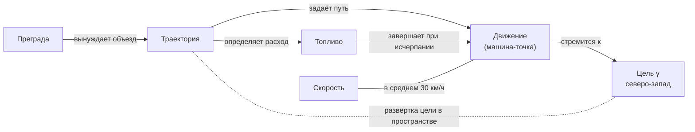
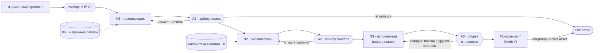

# Формальное промптирование

**Принципы, формальная модель и путь внедрения**

*Статья-манифест* · Андрей · Черновик для обсуждения · версия 0.3 · октябрь 2026

> Перенесено из PDF версии 0.3. Формулы набраны в LaTeX, GitHub отображает
> их как математику. Рисунки 1, 3 и 5 переданы таблицами, рисунки 2 и 4 —
> диаграммами Mermaid.

---

> **Аннотация.** Большие языковые модели (LLM) всё чаще работают исполнителями
> инженерных задач, но управляют ими по-прежнему текстом на естественном языке.
> Отсюда три системные проблемы: результат зависит от формулировки, не
> воспроизводится между запусками и версиями модели, а в мультиагентных системах
> накапливаются скрытые ошибки взаимодействия. В статье предлагается формальное
> промптирование (ФПм) — дисциплина, в которой модель рассматривается не как
> собеседник, а как ещё один слой абстракции между человеком и вычислительной
> системой. Языком этого слоя служит формальный промпт: конечное подмножество
> английского языка с ограниченной вариативной семантикой, занимающее
> промежуточное положение между кодом и естественным языком. Формулируются девять
> принципов ФПм. Вводится формальная модель: язык, обобщения и частные случаи,
> граф категорий и отношений, пространство реализаций. Доказывается, что отчёт
> о самостоятельных решениях модели не растёт при увеличении детализации
> спецификации, и даётся верхняя оценка энтропии интерпретации для языка
> с ограниченной семантикой. Описываются архитектура исполнения, в которой каждый
> нейросетевой шаг проверяет детерминированный арбитр, и модель разработки
> в среде-ноутбуке с локальными правками и уровнями согласованности. Вводятся
> измеримая сила последовательности, структурные веса наблюдаемых вопросов
> и жёсткие правила, которые арбитр проверяет до исполнения. Предлагаются путь
> внедрения — от протокола в конкретном продукте до модели, обученной на
> формальном языке, и языка программирования, — план экспериментальной проверки
> и критерий, отличающий выученное обобщение от шаблона имени.
>
> **Ключевые слова:** формальное промптирование, LLM, контролируемый язык,
> детерминированность, воспроизводимость, мультиагентные системы, декларативное
> программирование, подотчётность модели.

## Содержание

1. [Введение](#1-введение)
2. [Принципы](#2-принципы)
3. [Формальная модель](#3-формальная-модель)
4. [Архитектура исполнения](#4-архитектура-исполнения)
5. [Модель разработки: среда-ноутбук](#5-модель-разработки-среда-ноутбук)
6. [ФПм среди смежных подходов](#6-фпм-среди-смежных-подходов)
7. [Путь внедрения](#7-путь-внедрения)
8. [Границы применимости и открытые вопросы](#8-границы-применимости-и-открытые-вопросы)
9. [Заключение](#9-заключение)
10. [Список литературы](#список-литературы)
11. [Глоссарий](#a-глоссарий)

---

## 1. Введение

### 1.1. Проблема

Большие языковые модели перестали быть только собеседниками. Они пишут код,
разбирают инциденты, обслуживают базы данных и инфраструктуру, то есть работают
исполнителями внутри промышленных систем. Управляют ими при этом так же, как
собеседником: текстом на естественном языке. Для промышленной эксплуатации это
порождает три системные проблемы.

**Зависимость от формулировки.** Одна и та же по смыслу задача, записанная
разными словами, даёт разные результаты. Эффект велик и хорошо измерен: в работе
[23] одно лишь изменение форматирования промпта меняло точность модели
LLaMA-2-13B в режиме few-shot на величину до 76 процентных пунктов.

**Невоспроизводимость.** Ответ модели может различаться от запуска к запуску
даже при нулевой температуре. Одна из причин — зависимость численного результата
от размера батча на сервере, то есть от текущей нагрузки [15]. Результат
меняется и при смене версии модели, причём сильнее всего у промптов,
оставляющих часть требований невысказанной [28].

**Ошибки взаимодействия агентов.** Когда задача делится между несколькими
агентами, к ошибкам каждого добавляются ошибки их взаимодействия. В таксономии
отказов мультиагентных систем MAST [6] (14 видов отказов; авторы разметили более
1600 трасс семи популярных фреймворков) рассогласование агентов и недостаточная
проверка результатов составляют две из трёх групп отказов. Агенты общаются на
естественном языке, поэтому неверное понимание или необоснованное утверждение
одного агента без проверки уходит к следующему.

К этому добавляется избыточность. Модель общего назначения, которая
администрирует базу данных, умеет обсуждать рецепты, погоду и смысл жизни. Для
её работы это лишние параметры, лишние токены и лишние способы отклониться от
задачи.

### 1.2. Исходная идея

Формальное промптирование выросло из идеи, к которой автор пришёл в конце
2024 года, сравнивая существующие языки программирования. Её суть — сдвиг
градации. Привычные высокоуровневые языки становятся среднеуровневыми, а
по-настоящему высокоуровневым становится язык, построенный на нейросети. Вместо
кода человек пишет формальный промпт — декларативное описание желаемого
результата на ограниченном языке. Императивную часть, то есть то, как достичь
результата, выполняет модель. Поговорить с такой моделью нельзя: в языке нет
пожеланий доброго утра и вопросов о самочувствии. Она знает конечный перечень
слов, каждое из которых однозначно или имеет немного смыслов.

Позднее стало ясно, что идея шире языка программирования. Тот же подход
применим к любому промышленному использованию LLM: к оркестрации инженерных
задач, к обмену сообщениями между агентами, к обучению специализированных
моделей. Эту общую дисциплину мы называем формальным промптированием, а язык
программирования на её основе считаем одним из её применений.

### 1.3. Вклад статьи

1. Сформулированы девять принципов ФПм (раздел 2).
2. Введена формальная модель: язык с ограниченной вариативной семантикой,
   обобщения и частные случаи, граф категорий и отношений, пространство
   реализаций. Доказана монотонность отчёта о самостоятельных решениях модели
   по детализации спецификации и получена верхняя оценка энтропии
   интерпретации. Предложены измеримые согласованность и правильность
   последовательности и правило выбора весов (раздел 3).
3. Описаны архитектура исполнения с детерминированным арбитражем каждого
   нейросетевого шага и жёсткими правилами, а также модель разработки в
   среде-ноутбуке с зависимостями по чтению и записи и классификацией правок
   (разделы 4 и 5).
4. Проведено разграничение с вайбкодингом и смежными подходами (раздел 6).
5. Предложены путь внедрения, минимальный набор требований и план
   экспериментальной проверки (раздел 7). Перечислены границы применимости и
   открытые вопросы; для обучения обобщениям дан критерий проверки (раздел 8).

## 2. Принципы

> «Ни при каких обстоятельствах нейросеть не должна уметь отвечать на вопрос
> „Как у меня дела?“»

**П1. Модель — слой абстракции, а не собеседник.** Привычная цепочка выглядит
так: пользователь, прикладное ПО, операционная система, ядро, аппаратура. ФПм
добавляет в неё ещё один слой — модель (рис. 1). Ядро операционной системы не
поддерживает разговор о погоде, и модель-слой не должна его поддерживать.
Отсюда минимальность данных: в обучающих данных модели есть только то, что
нужно для её работы. Модели, которая пишет код или управляет инфраструктурой,
не нужны сведения о выпечке печенья и о том, чем заняться в воскресенье, — ни
в монолитной, ни в мультиагентной системе. Вход вне языка — это ошибка («такой
последовательности нет в языке»), а не повод для ответа.

| Привычная схема | Схема ФПм |
|---|---|
| Пользователь | Пользователь |
| Прикладное ПО | **LLM — слой ФП** |
| Операционная система | Прикладное ПО |
| Ядро ОС | Операционная система |
| Аппаратура | Ядро ОС |
| | Аппаратура |

*Язык слоя — формальный промпт; вход вне языка — ошибка.*

*Рис. 1. Модель как ещё один слой абстракции между пользователем и машиной
(принцип П1).*

**П2. Конечный язык с ограниченной вариативной семантикой.** Формальный промпт
пишется на искусственном подмножестве английского языка с конечным словарём.
Английский выбран потому, что на нём больше всего данных для обучения. Каждое
слово либо однозначно, либо имеет немного смыслов, условно два или три. В
естественном языке у слова apple есть смыслы «продукт», «компания», «метафора
первородного греха» и другие. В формальном промпте их множество ограничено,
например продуктом и компанией, и пространство для недопонимания становится
малым. Какой из допустимых смыслов имеется в виду, определяет контекст: соседние
объекты и их классы. Такую семантику мы называем вариативной.

**П3. Обобщения и частные случаи.** Слова и целые последовательности слов
формального промпта являются обобщениями: например, обобщённое понятие «сервер»
или «функция». Модель обучена распознавать, какое обобщение означает данная
последовательность. Частные случаи — места, которые заполняет оператор:
значения, параметры, имена. Поэтому модели не нужно разбирать программу
целиком: достаточно распознать обобщённую часть и применить к ней частные
случаи. Это даёт точность и экономию вычислений и токенов. Тот же принцип
относится к обучению: понятие «сервер» обобщается один раз, а дальше в данные
идут его частные случаи (server1, server2, …) с признаком принадлежности
обобщению.

**П4. Классы обобщения и одноимённость.** Одно и то же слово может принадлежать
разным классам обобщения. «Бензин как топливо» и «бензин, разлитый на дороге» —
одноимённые объекты разных категорий в том смысле, в каком об одноимённых
вещах писал ещё Аристотель [1]. Их различают по контексту и по соседним
объектам. Класс определяет, к какой части программы относится высказывание.

**П5. Разделение «что» и «как».** Оператор описывает желаемый результат и
отношения предметной области, модель строит реализацию. Программист, получивший
техническое задание от нефтеперерабатывающего завода, не обязан разбираться в
крекинге: отношения предметной области он берёт из задания, а реализацию — из
своего ремесла. Так же и модель: отношения ей дают промпт и подгружаемые
скиллы, а сама она достраивает только реализацию. Если задаче нужно отношение,
которого нет ни в промпте, ни в скиллах, система возвращает ошибку, а не
догадку. Этот принцип отделяет ФПм от вайбкодинга (раздел 6.1).

**П6. Нейросеть предлагает, алгоритм разрешает.** Между нейросетевыми шагами
всегда стоит детерминированная проверка. Если модель запросила для задачи
веб-дизайна навыки бэкенда, алгоритм отказывает ей и называет причину. Ни один
результат модели не проходит дальше без такой проверки.

**П7. Подотчётность.** Каждое важное самостоятельное решение модели фиксируется
в отчёте: что выбрано, из каких вариантов и почему. Логируются не только ошибки,
но и решения. Отчёт по умолчанию пишется на том же формальном языке, а перевод
на естественный язык — подключаемый скилл. Детализация отчёта настраивается.

**П8. Локальность правок и приоритет человека.** Формальный промпт типизирован
по классам обобщения. Правка, относящаяся к классу «преграды», меняет код этого
класса и только зависящие от него части. Человек может править и
сгенерированный код; его правки помечаются и защищаются: для языка пользователь
всегда прав.

**П9. Единый протокол.** Тот же формальный язык — единственный язык обмена
между агентами. Это исключает рассогласование формулировок и делает утверждения
агентов проверяемыми.

## 3. Формальная модель

Раздел уточняет принципы П2–П8. Цель — не полная семантика языка (конкретный
синтаксис формального промпта — предмет отдельной работы), а набор
определений, в которых утверждения ФПм можно сформулировать точно и проверить.

### 3.1. Язык

**Определение 1 (язык формальных промптов).** Язык — это тройка
$\mathcal{L} = (W, \mu, \Gamma)$, где $W$ — конечный словарь (подмножество слов
английского языка); $\mu : W \to 2^{\mathbb{M}} \setminus \lbrace \varnothing \rbrace$ —
функция смыслов, сопоставляющая слову непустое множество смыслов из универсума
$\mathbb{M}$, причём $|\mu(w)| \le k$ для всех $w \in W$ при малом $k$
(ориентир: $k \le 3$); $\Gamma$ — грамматика, задающая допустимые
последовательности слов и их структуру: порядок связывания и область действия
операторов. Промпт $P$ принадлежит языку $\mathcal{L}$, если он порождается
грамматикой $\Gamma$ из слов $W$. Иначе разбор возвращает ошибку
$\bot_{\mathrm{syn}}$ ещё до обращения к модели.

**Определение 2 (расстановка смыслов).** Пусть промпт $P$ содержит употребления
слов $w_1, \dots, w_n$. Расстановка смыслов — кортеж $a = (m_1, \dots, m_n)$,
где $m_i \in \mu(w_i)$. Контекст задаёт ограничения совместимости, например
класс соседнего объекта; $\mathcal{A}(P)$ — множество расстановок,
удовлетворяющих этим ограничениям. Промпт лексически однозначен, если
$|\mathcal{A}(P)| = 1$.

**Замечание 1.** Если ограничения совместимости заданы правилами классов, а не
суждением модели, проверка условия $|\mathcal{A}(P)| = 1$ детерминирована.
Тогда разбор может отвергать лексически неоднозначный промпт и указывать место
неоднозначности.

### 3.2. Три источника расхождения

Расхождение между тем, что хотел оператор, и тем, что поняла система, имеет три
разных источника (табл. 1). Лексическая неоднозначность: у слова несколько
смыслов. С ней работают ограничение $|\mu(w)| \le k$ и разрешение по контексту.
Структурная неоднозначность: каждое слово однозначно, но их сочетание допускает
несколько разборов. С ней работает грамматика, которая обязана либо запрещать
такие конструкции, либо фиксировать их чтение. Недоопределённость: о чём-то не
сказано вообще. Фраза «отсортировать пользователей по имени» состоит из
однозначных слов, но не говорит, учитывать ли регистр, куда ставить «ё», как
упорядочить одинаковые имена и что делать с пустыми. Ограничение словаря на
недоопределённость не влияет, а между тем это главный источник ошибок. Модели
сами угадывают невысказанные требования примерно в 41 % случаев, но промпты с
невысказанными требованиями примерно вдвое чаще деградируют при смене модели
или формулировки [28]. Поэтому в ФПм с недоопределённостью работает отдельный
механизм — разделение «что» и «как» с отчётом (раздел 3.6).

*Таблица 1. Источники расхождения между замыслом оператора и интерпретацией
системы*

| Источник | Пример | Механизм ФПм |
|---|---|---|
| Лексическая неоднозначность | apple: продукт, компания или метафора; «бензин»: топливо или предмет на дороге | Конечный словарь, $\lvert\mu(w)\rvert \le k$, разрешение смысла по классам соседних объектов |
| Структурная неоднозначность | «все пользователи, кроме админов старше 30»: возраст относится ко всем или только к админам? | Грамматика с фиксированной областью действия операторов, канонические формы |
| Недоопределённость | «отсортировать по имени»: регистр, «ё», одинаковые имена, пустые значения | Разделение «что/как»: недостающее отношение предметной области — ошибка $\bot_{\mathrm{undef}}$, решение реализации — запись в отчёте |

### 3.3. Обобщения и частные случаи

**Определение 3 (обобщение, частный случай).** Обобщение $g \in \mathcal{G}$ —
схема со слотами $g(x_1 : \tau_1, \dots, x_r : \tau_r)$, где $\tau_j$ — типы
слотов. Частный случай — подстановка $\theta = \lbrace x_j \to v_j \rbrace$
значений $v_j \in \tau_j$. Экземпляр $g\theta$ — обобщение с заполненными
слотами. С точки зрения модели промпт — набор экземпляров и отношений между
ними: $P \simeq (g_1\theta_1, \dots, g_t\theta_t;\ R_P)$.

Модель выучивает отображение «обобщение → шаблон реализации» один раз для
каждого $g$, а частные случаи подставляет. Отсюда экономия: модели не нужно
восстанавливать смысл всего текста, достаточно распознать $g$ и применить
$\theta$. В обучающих данных обобщение задаётся один раз, а дальше идут его
частные случаи с меткой обобщения. Как гарантировать, что модель выучит именно
понятие, а не шаблон имени вида «server + число», — открытый вопрос.
Необходимое условие к данным и критерий проверки приведены в разделе 8.3.

### 3.4. Классы обобщения и одноимённость

**Определение 4 (класс, одноимённость).** Пусть $\mathcal{C}$ — конечное
множество классов обобщения и $\mathrm{cls} : \mathcal{G} \to \mathcal{C}$. Два
употребления одного слова одноимённы, если их обобщения принадлежат разным
классам. Например, «бензин» в роли топлива принадлежит классу Топливо, а
«бензин на дороге» — классу Преграда. Для правки или ячейки $c$ через
$\kappa(c) \subseteq \mathcal{C}$ обозначим множество классов, которые она
затрагивает.

### 3.5. Программа как граф категорий и отношений

**Определение 5 (граф программы).** Граф программы — четвёрка
$G_P = (C_P, R_P, \gamma, \preceq)$, где $C_P \subseteq \mathcal{C}$ — классы,
участвующие в программе; $R_P \subseteq C_P \times \mathcal{R} \times C_P$ —
типизированные отношения между ними (здесь $\mathcal{R}$ — словарь типов
отношений: «изменяет», «определяет», «ограничивает», «завершает» и т. д.);
$\gamma \in C_P$ — цель; $\preceq$ — частичный порядок приоритетов, которым
разрешаются конфликты отношений. По умолчанию цель — наибольший элемент: всё
остальное определяется через отношение к ней.

**Пример 1 (машина на северо-запад).** Оператор хочет, чтобы машина ехала на
северо-запад, объезжала преграды, двигалась, пока есть топливо, и держала
среднюю скорость 30 км/ч. Классы: Цель, Движение, Траектория, Преграда,
Топливо, Скорость. Отношения показаны на рис. 2: преграда вынуждает объезд и
тем изменяет траекторию; траектория определяет расход топлива; исчерпание
топлива завершает движение; движение стремится к цели. Траектория при этом —
развёртка цели в пространстве.

*Рис. 2. Граф программы из примера 1. Цель — наибольший элемент порядка
приоритетов; пунктир показывает, что траектория есть развёртка цели в
пространстве.*

Интуитивная картина такой программы — точка, которую притягивает цель, а
остальные категории влияют на её путь. Это метафора, а не механика: отношения
не складываются как векторы сил. Когда они противоречат друг другу (объезд
длиннее остатка хода), конфликт разрешает порядок приоритетов $\preceq$, а не
сумма.

**Замечание 2.** Граф $G_P$ естественно порождает категорию в смысле [10] —
категорию путей графа: объекты — классы, морфизмы — цепочки отношений (включая
пустые), композиция — сцепление цепочек. На этом языке влияние одного класса на
другой — существование морфизма между ними, а глубина влияния — длина
кратчайшего пути. Это понятие используется в разделе 5.3.

### 3.6. Разделение «что» и «как»: пространство реализаций и отчёт

**Определение 6 (знание и его замкнутость).** Знание о предметной области
$K = K(P, \Sigma)$ — множество отношений, заданных промптом $P$ и загруженными
скиллами $\Sigma \subseteq \mathrm{Lib}$. Базовая модель отношений предметной
области не содержит: она знает язык и способы реализации (П1, П5). Пусть
$\mathrm{Req}(P)$ — отношения, без которых задачу нельзя решить. Сборка
определена, только если $\mathrm{Req}(P) \subseteq K$. Иначе система возвращает
ошибку с перечнем недостающих отношений:

$$
\mathrm{Build}(P) = \bot_{\mathrm{undef}}\bigl(\mathrm{Req}(P) \setminus K\bigr).
$$

Модель не пополняет $K$ сама.

**Определение 7 (пространство реализаций, недоопределённость).** Пусть
$\mathcal{P}$ — множество всех программ, $\mathrm{Impl}(K) \subseteq \mathcal{P}$ —
программы, удовлетворяющие всем отношениям из $K$. Наблюдаемый вопрос —
отображение $q : \mathcal{P} \to A_q$, сопоставляющее программе видимый
пользователю аспект её поведения: с какой стороны объезжать преграду, как
распределять скорость, что делать при нехватке топлива. Пусть $Q$ — множество
наблюдаемых вопросов. Программы $I_1$ и $I_2$ наблюдательно эквивалентны
($I_1 \approx I_2$), если $q(I_1) = q(I_2)$ для всех $q \in Q$. Вопрос $q$
недоопределён, если принимает на $\mathrm{Impl}(K)$ больше одного значения:

$$
U(K) = \bigl\lbrace\, q \in Q : |q(\mathrm{Impl}(K))| > 1 \,\bigr\rbrace.
$$

**Определение 8 (отчёт).** Модель выбирает реализацию
$I^\ast \in \mathrm{Impl}(K)$. Отчёт — множество записей

$$
R(K, I^\ast) = \bigl\lbrace\, \langle q,\ q(I^\ast),\ q(\mathrm{Impl}(K)),\ \rho_q \rangle : q \in U(K) \setminus Q_{\mathrm{off}} \,\bigr\rbrace,
$$

где $q(I^\ast)$ — сделанный выбор, $q(\mathrm{Impl}(K))$ — допустимые
альтернативы, $\rho_q$ — обоснование, а $Q_{\mathrm{off}}$ — вопросы, о которых
оператор в конфигурации попросил не сообщать («про топливо не писать»).

**Утверждение 1 (монотонность отчёта).** Пусть $K \subseteq K'$ и
$\mathrm{Impl}(K') \neq \varnothing$. Тогда
$\mathrm{Impl}(K') \subseteq \mathrm{Impl}(K)$, $U(K') \subseteq U(K)$ и при
одном и том же $Q_{\mathrm{off}}$ число записей отчёта не возрастает:
$|R(K', \cdot)| \le |R(K, \cdot)|$.

*Доказательство.* Программа, удовлетворяющая всем отношениям из $K'$,
удовлетворяет и всем отношениям из $K \subseteq K'$, поэтому
$\mathrm{Impl}(K') \subseteq \mathrm{Impl}(K)$. Если $q \notin U(K)$, то $q$
постоянен на $\mathrm{Impl}(K)$, а значит, и на его непустом подмножестве
$\mathrm{Impl}(K')$; следовательно, $q \notin U(K')$. Отсюда
$U(K') \subseteq U(K)$. Число записей отчёта равно
$|U(\cdot) \setminus Q_{\mathrm{off}}|$, и оно не возрастает. □

Утверждение 1 делает точной формулу «детализация и отчёт — сообщающиеся
сосуды»: чем меньше оператор написал, тем больше ему предстоит прочитать.
Отсюда ползунок детализации с двумя границами. Нижняя граница —
$K \supseteq \mathrm{Req}(P)$: ниже неё система выдаёт ошибку, а не догадку.
Верхняя граница — $U(K) = \varnothing$: всё наблюдаемое поведение
зафиксировано. В пределе это императивное описание, то есть код, записанный в
более читаемой форме. Оператор волен выбрать любую точку между границами и
уточнять ровно там, где ему важно.

**Следствие 1 (режим SQL).** Если $U(K) = \varnothing$, то все реализации из
$\mathrm{Impl}(K)$ наблюдательно эквивалентны, отчёт пуст и выбор модели
пользователю не виден.

Именно в этом режиме декларативные системы десятилетиями безопасно отдают
машине выбор «как». Оптимизатор СУБД выбирает план запроса [24], но для запроса
с однозначно определённым результатом любой план возвращает те же строки (если
не включать в $Q$ вопросы производительности). ФПм распространяет
декларативный подход на случай $U(K) \neq \varnothing$, где выбор модели виден,
и компенсирует это отчётом.

**Пример 2 (продолжение примера 1).** Пусть промпт задаёт только цель, объезд
преград, движение до исчерпания топлива и среднюю скорость, а понятие преграды
определяет подключённый скилл вождения (оно входит в $K$ и потому не является
решением модели). Фрагмент отчёта приведён в табл. 2. Если оператор допишет
сторону объезда и порядок действий при нехватке топлива, соответствующие записи
исчезнут из отчёта — в точном соответствии с утверждением 1.

*Таблица 2. Фрагмент отчёта для скудного промпта из примера 1 (содержание
записей, а не синтаксис)*

| Класс | Вопрос $q$ | Выбор $q(I^\ast)$ | Основание $\rho_q$ |
|---|---|---|---|
| Траектория | С какой стороны объезжать преграду | Со стороны меньшей длины объезда | В промпте не задано |
| Скорость | Как обеспечить среднюю скорость 30 км/ч | 30 км/ч вне манёвров, снижение на объезде | В промпте не задано |
| Топливо | Остатка хода не хватает на объезд | Остановка до начала объезда | Приоритет: исчерпание топлива завершает движение |
| Цель | Путь на северо-запад перекрыт полностью | Временный отход от цели для обхода; при неудаче — остановка | В промпте не задано |

### 3.7. Неоднозначность: энтропия интерпретации и сила последовательности

**Определение 9 (энтропия интерпретации).** Пусть для последовательности $s$
система реализует распределение интерпретаций $p(\cdot \mid s)$ на множестве
смыслов высказываний. Энтропия интерпретации

$$
H(s) = -\sum_{m} p(m \mid s) \log_2 p(m \mid s).
$$

Последовательность $s$ сильнее последовательности $s'$ с тем же замыслом, если
$H(s) < H(s')$. Сильной назовём последовательность, у которой
$H(s) \le \varepsilon$ для заданного порога $\varepsilon$.

**Утверждение 2 (оценка энтропии).** Пусть грамматика $\Gamma$ фиксирует
структуру $s$, так что интерпретация $s$ однозначно определяется расстановкой
смыслов; система выбирает только согласованные расстановки
$a \in \mathcal{A}(s)$; $s$ содержит $n$ знаменательных слов
$w_1, \dots, w_n$. Тогда

$$
H(s) \le \log_2 |\mathcal{A}(s)| \le \sum_{i=1}^{n} \log_2 |\mu(w_i)| \le n \log_2 k.
$$

*Доказательство.* Интерпретация — функция от расстановки $a$, а энтропия
функции случайной величины не превосходит энтропии самой величины. Энтропия
распределения, сосредоточенного на множестве $\mathcal{A}(s)$, не превосходит
$\log_2 |\mathcal{A}(s)|$. Наконец,
$\mathcal{A}(s) \subseteq \mu(w_1) \times \dots \times \mu(w_n)$ и
$|\mu(w_i)| \le k$. □

Из утверждения 2 следуют три вывода.

1. Если контекст оставляет одну согласованную расстановку
   ($|\mathcal{A}(s)| = 1$), то $H(s) = 0$: лексически однозначный промпт с
   фиксированной структурой интерпретируется однозначно.
2. В естественном языке не ограничены ни словарь, ни число смыслов слова
   (метафоры, новые значения), поэтому аналогичной оценки нет. Ограничение
   языка превращает разброс интерпретаций из неизвестной величины в величину,
   ограниченную сверху.
3. Энтропия по смыслам измеряет только неоднозначность. Однозначная, но
   неполная спецификация имеет $H(s) = 0$ и при этом $U(K) \neq \varnothing$.
   Поэтому ФПм нужны оба механизма: ограниченная семантика против
   неоднозначности и отчёт против недоопределённости.

Отсюда положение формального промпта на шкале языков (рис. 3). У кода
семантика задана стандартом языка и $H = 0$, но человек пишет и «что», и «как».
На естественном языке писать мало, но $H$ велика и сверху ничем не ограничена.
Формальный промпт занимает середину: $H$ ограничена сверху и обращается в ноль
для однозначных промптов, а человек пишет только «что». Шаг влево — псевдокод,
ещё левее — язык программирования. Шаг вправо — полуформальный текст, ещё
правее — естественный язык.

| Язык программирования | Псевдокод | **ФПм** | Полуформальный текст | Естественный язык |
|:---:|:---:|:---:|:---:|:---:|
| ← растёт объём того, что пишет человек | | **зона баланса** | | растёт энтропия интерпретации $H$ → |

*Рис. 3. Качественная схема (не данные): положение формального промпта между
кодом и естественным языком. Левее ФПм растёт объём записи, правее — энтропия
интерпретации.*

**Сильные и слабые последовательности.** Язык сознательно допускает несколько
способов записать один замысел: это цена близости к естественному языку.
Разные записи различаются силой. Тезис ФПм: оператор, выстроивший логически
стройную и однозначную последовательность, получает лучший результат:
планировщик меньше ошибается на разборе и точнее собирает пакет задачи,
библиотекарь точнее подбирает скиллы. Оценка утверждения 2 ограничивает
разброс, а канонические формы, если их ввести, устраняют его совсем. Где
провести черту между свободой формулировок и каноничностью — параметр
проектирования языка (раздел 8.2). Чтобы тезис о силе стал проверяемым, силу
нужно измерять (раздел 3.8).

### 3.8. Измерение силы последовательности

Утверждение 2 работает на уровне языка. Если разбор отвергает промпты с
$|\mathcal{A}(s)| > 1$ (замечание 1), то у всех принятых промптов $H(s) = 0$, и
все они одинаково «сильные». Между тем наблюдаемый эффект — разные результаты у
однозначных записей одного замысла — возникает в модели, а не в грамматике.
Поэтому силу нужно измерять по поведению модели. Пусть при фиксированной
температуре генерации $T$ модель выполняет $N$ независимых прогонов
последовательности $s$, $I_1, \dots, I_N$ — полученные интерпретации, а
$I^\ast$ — интерпретация, которую задумал оператор.

**Определение 10 (согласованность и правильность).** Согласованность и
правильность последовательности $s$ — доля совпадающих пар прогонов и доля
прогонов с задуманной интерпретацией:

$$
\hat c(s) = \binom{N}{2}^{-1} \sum_{a<b} \mathbf{1}\bigl[I_a \approx I_b\bigr],
\qquad
\hat p(s) = \frac{1}{N} \sum_{a=1}^{N} \mathbf{1}\bigl[I_a \approx I^\ast\bigr].
$$

**Утверждение 3 (согласованность и энтропия).** Если прогоны — независимые
выборки из распределения интерпретаций $p(\cdot \mid s)$, то

$$
\mathbb{E}\,\hat c(s) = \sum_{m} p(m \mid s)^2 = 2^{-H_2(s)},
\qquad
H_2(s) = -\log_2 \sum_{m} p(m \mid s)^2 \le H(s).
$$

*Доказательство.* Для каждой пары $a < b$ две независимые выборки попадают в
одну интерпретацию с вероятностью $\sum_m p(m \mid s)^2$, а усреднение по парам
сохраняет математическое ожидание. Обозначим $p_m = p(m \mid s)$. Тогда
$\sum_m p_m^2 = \mathbb{E}_p[p_m]$, и по неравенству Йенсена для выпуклой
функции $-\log_2$ имеем
$-\log_2 \mathbb{E}_p[p_m] \le \mathbb{E}_p[-\log_2 p_m] = H(s)$. □

Величина $H_2$ — энтропия Реньи второго порядка [22]. Её оценка по доле
совпавших пар несмещённая, тогда как оценка шенноновской энтропии по частотам
при малом $N$ занижена. Метрика $D_t$ из раздела 7.4 — это в точности $\hat c$
для одной записи задачи.

**Согласованность — не правильность.** Последовательность, которую модель
стабильно понимает неверно, даёт $\hat c \approx 1$ и $\hat p \approx 0$.
Поэтому тезис о силе становится проверяемой гипотезой: среди записей одного
замысла согласованность и правильность положительно связаны. Если гипотеза не
подтвердится, силу следует определять напрямую через правильность
$p(m^\ast \mid s)$. Обе величины зависят от температуры $T$, поэтому она входит
в определение замера; в рабочем режиме генерация фиксирована (свойство (D),
раздел 3.10).

**Градуированная версия.** Индикатор совпадения можно заменить близостью.
Представим интерпретацию $I$ множеством пар «вопрос — ответ»
$X(I) = \lbrace (q, q(I)) : q \in Q \rbrace$, а меру множества $Z$ — суммой
весов его вопросов: $\mu(Z) = \sum_{(q,\cdot) \in Z} w(q)$.

**Утверждение 4 (метрика интерпретаций).** При положительных весах взвешенное
расстояние Жаккара

$$
\delta(X, Y) = \frac{\mu(X \mathbin{\triangle} Y)}{\mu(X \cup Y)},
\qquad
\delta(\varnothing, \varnothing) = 0,
$$

является метрикой на конечных множествах.

*Доказательство.* Величина $\rho(X, Y) = \mu(X \mathbin{\triangle} Y)$ —
метрика: она симметрична, обращается в ноль только при $X = Y$ (веса
положительны), а неравенство треугольника следует из включения
$X \mathbin{\triangle} Z \subseteq (X \mathbin{\triangle} Y) \cup (Y \mathbin{\triangle} Z)$.
Поскольку $\mu(X) + \mu(Y) + \mu(X \mathbin{\triangle} Y) = 2\mu(X \cup Y)$ и
$\rho(X, \varnothing) = \mu(X)$, имеем

$$
\delta(X, Y) = \frac{2\rho(X, Y)}{\rho(X, \varnothing) + \rho(Y, \varnothing) + \rho(X, Y)},
$$

то есть $\delta$ — преобразование Штейнгауза метрики $\rho$ с опорной точкой
$\varnothing$, а оно сохраняет метричность [8]. □

Градуированные согласованность $\tilde c(s)$ и правильность $\tilde p(s)$
получаются заменой индикатора $\mathbf{1}[I \approx I']$ на
$1 - \delta\bigl(X(I), X(I')\bigr)$. Наблюдательная эквивалентность — частный
случай: $I \approx I'$ тогда и только тогда, когда $\delta = 0$. Метрика
зависит от весов $w$; как их выбирать, описано в следующем разделе.

### 3.9. Веса наблюдаемых вопросов

От весов зависит, какие расхождения считаются существенными. Пусть $Q$ состоит
из четырёх вопросов табл. 2, прогон A отличается от B только стороной объезда,
а от C — только поведением при нехватке топлива. При равных весах
$\delta(A, B) = \delta(A, C) = 0{,}4$: ошибка со стороной объезда стоит столько
же, сколько остановка посреди дороги. Если вес вопроса о топливе равен 5, а
остальных — 1, то $\delta(A, B) \approx 0{,}22$, а $\delta(A, C) \approx 0{,}77$.
Требования к весам:

- **(В1)** один вес для всех сравниваемых прогонов, иначе $\delta$ перестаёт
  быть метрикой;
- **(В2)** $w(q) > 0$; нулевой вес (вопросы из $Q_{\mathrm{off}}$) превращает
  $\delta$ в псевдометрику: прогоны, различающиеся только в выключенных
  вопросах, становятся неразличимы. Это допустимо, если сделано осознанно;
- **(В3)** веса фиксируются до замера, иначе подбором весов можно получить
  любой вывод.

ФПм берёт веса из структуры эталонного графа. Эталонный граф предметной области
поставляет скилл (например, `@driving` или `@nginx`) и версионирует его вместе
с собой; для конкретной задачи к нему добавляются отношения промпта.
Простейший структурный вес — $w(q) = 1 + n(q)$, где $n(q)$ — число отношений
эталонного графа, которые опираются на класс вопроса $q$. Он вычисляется
детерминированно и не поддаётся подгонке под нужный результат. Автор скилла
тем самым задаёт эталон правильности, но эта роль не новая: по П5 отношения
предметной области и так приходят из скиллов. Её не устраняют, а делают явной:
эталон «`@nginx` версии 2.3» — такой же объявленный параметр замера, как
температура.

Центральность в графе — не важность. Ограничение «не разрывать активные
соединения» касается одного класса, а нарушить его дороже всего. Поэтому
критичность выражается не весом, а жёстким правилом (раздел 4.8). В метрике
жёсткое правило работает как порог: прогон, нарушивший его, считается неверным
независимо от остальных ответов, а $\delta$ вычисляется по остальным вопросам.

### 3.10. Детерминированность, устойчивость, локальность, идемпотентность

Тезис «ФПм решает задачу детерминированности и идемпотентности» распадается на
четыре разных свойства с разными механизмами (табл. 3). Пусть $\oplus$ —
применение правки к промпту, а $\approx$ — наблюдательная эквивалентность
программ.

**Определение 11 (свойства сборки).**

- **(D) Детерминированность:** повторная сборка того же промпта $P$ при той же
  конфигурации даёт тот же результат.
- **(R) Устойчивость к перефразированию:** если $P$ и $P'$ совпадают по смыслу,
  то $\mathrm{Build}(P) \approx \mathrm{Build}(P')$.
- **(L) Локальность:** программы $\mathrm{Build}(P \oplus \Delta)$ и
  $\mathrm{Build}(P)$ совпадают во всём коде, кроме относящегося к классам из
  окрестности $N_d(\kappa(\Delta))$ затронутых классов (раздел 5.3).
- **(I) Идемпотентность правок:** $(P \oplus \Delta) \oplus \Delta = P \oplus \Delta$.

**Утверждение 5 (идемпотентность декларативных правок).** Пусть правка $\Delta$
задаёт значения отношений: для каждого ключа $r$ из области $\Delta$ значение
$r$ после применения равно $\Delta(r)$ независимо от прежнего (последняя запись
побеждает). Тогда $(P \oplus \Delta) \oplus \Delta = P \oplus \Delta$.

*Доказательство.* Повторное применение присваивает каждому ключу из области
$\Delta$ то же значение $\Delta(r)$, которое он уже имеет, и не затрагивает
остальные ключи. □

Императивная правка вида «увеличить скорость на 5 км/ч» этим свойством не
обладает: применённая дважды, она даёт другой результат. Поэтому ячейки
формального промпта декларативны: они задают значения, а не приращения.

Язык сам по себе не обеспечивает свойство (D): повторяемость при одном и том же
входе зависит от параметров генерации и от того, как считает аппаратура. В
эксперименте [15] 1000 генераций одного запроса при нулевой температуре дали
80 различных ответов, а после перехода на вычислительные ядра, не зависящие от
размера батча, все 1000 совпали. ФПм не отменяет эту инженерную работу, а
закрепляет её в конфигурации языка вместе с кэшем, который не даёт системе
собрать одну и ту же программу разным кодом.

*Таблица 3. Четыре свойства сборки и механизмы, которые их обеспечивают*

| Свойство | Чем обеспечивается | Уровень |
|---|---|---|
| (D) Детерминированность | Фиксированные параметры генерации и кэш артефактов в конфигурации языка; вычисления, не зависящие от размера батча [15] | Система |
| (R) Устойчивость к перефразированию | Конечный словарь, $\lvert\mu(w)\rvert \le k$, канонические формы (утверждение 2) | Язык |
| (L) Локальность | Типизация правок по классам; арбитр сверяет изменения кода с окрестностью $N_d(\kappa(\Delta))$ | Язык и арбитр |
| (I) Идемпотентность | Декларативность ячеек (утверждение 5) | Язык |

## 4. Архитектура исполнения

### 4.1. Модули и протокол «предложение — решение»

Конвейер сборки (рис. 4) чередует нейросетевые шаги и детерминированные
арбитры — в исходной формулировке алгоритмическую проверку «на if и else».

- **Разбор.** Детерминированно проверяет, что промпт принадлежит языку
  $\mathcal{L}$, и, если правила классов заданы, что он лексически однозначен.
- **N1 — планировщик.** Выделяет обобщения, частные случаи и классы, формирует
  сжатый пакет задачи с пометками $\pi$, ищет в кэше и прежних работах готовые
  артефакты.
- **A1 — арбитр плана.** Проверяет, что каждое отношение предметной области, на
  которое опирается план, есть в $K$ (иначе $\bot_{\mathrm{undef}}$ и
  эскалация), и что классы плана совпадают с объявленными в промпте.
- **N2 — библиотекарь.** По пакету формирует запрос скиллов $\Sigma$ из
  библиотеки $\mathrm{Lib}$ и заодно проверяет, не ошибся ли планировщик.
- **A2 — арбитр скиллов.** Проверяет, что запрошенные скиллы существуют и
  совместимы с задачей (определение 12); при отказе называет причину на
  формальном языке.
- **N3 — исполнители.** Генерируют код по частям параллельно (раздел 4.4).
- **A3 — сборка и проверка.** Главный исполнитель собирает части, исполняет
  тесты и сверяет результат со спецификацией. При расхождении он запрашивает у
  библиотекаря скилл отладки и возвращает задачу исполнителям.

Порядок шагов приведён в алгоритме 1. Число повторов на каждом шаге ограничено
величиной $r_{\max}$. Когда повторы исчерпаны или решение не выводится из
скиллов, кэша и прежних работ, задача эскалируется оператору (раздел 4.6).

### 4.2. Детерминированный арбитр

**Определение 12 (допустимые классы).** Пусть
$\mathrm{req} : \mathcal{C} \to 2^{\mathcal{C}}$ — таблица требований классов:
например, класс «форма обратной связи» требует класс «серверная обработка».
Допустимые классы задачи — замыкание объявленных в промпте классов по этой
таблице: $\mathrm{Adm}(P) = \mathrm{cl}_{\mathrm{req}}(\kappa(P))$. Набор
скиллов $\Sigma$ принимается, если $\Sigma \subseteq \mathrm{Lib}$ и
$\mathrm{cls}(s) \in \mathrm{Adm}(P)$ для всех $s \in \Sigma$.

Совместимость вычисляется не по общему «типу задачи», а по классам, которые
явно объявлены в промпте. Поэтому сайт с формой обратной связи законно получает
серверный скилл, а сайт без неё — нет. Таблица $\mathrm{req}$ — часть
библиотеки и сопровождается вместе со скиллами. Все проверки арбитров сводятся
к поиску по таблицам и сравнению множеств; вероятностных решений в них нет.

*Рис. 4. Конвейер сборки: каждый нейросетевой шаг проверяется
детерминированным арбитром (принцип П6). Отказы возвращаются с причиной на
формальном языке; нерешаемые вопросы эскалируются оператору. Прямоугольники —
нейросетевые шаги, шестиугольники — детерминированные, цилиндры — данные и
хранилища.*

**Алгоритм 1. Сборка формального промпта**

*Вход:* промпт $P$, библиотека $\mathrm{Lib}$, конфигурация. *Выход:* программа
$I^\ast$ и отчёт $R$ либо ошибка.

1. Если $P \notin \mathcal{L}$, вернуть $\bot_{\mathrm{syn}}$.
2. Если в кэше есть артефакт для пары (промпт, конфигурация), вернуть его.
3. Не более $r_{\max}$ раз: $\pi \leftarrow N_1(P)$, проверить $A_1(\pi)$. Если
   $A_1$ сообщает о недостающих отношениях, вернуть $\bot_{\mathrm{undef}}$ и
   эскалировать вопрос оператору.
4. Не более $r_{\max}$ раз: $\Sigma \leftarrow N_2(\pi)$, проверить
   $A_2(\Sigma, P)$; при отказе передать причину библиотекарю.
5. Для каждой части $u$ плана $\pi$ параллельно:
   $\mathrm{code}_u \leftarrow N_3(u, \Sigma)$.
6. $I \leftarrow$ сборка частей. Если проверка $A_3(I, P)$ не пройдена,
   запросить скилл отладки и вернуться к шагу 5 (не более $r_{\max}$ раз).
7. $R \leftarrow$ записи о решениях из $U(K) \setminus Q_{\mathrm{off}}$,
   принятых на шагах 3–6.
8. Сохранить $I$ в кэш и вернуть $(I, R)$.

### 4.3. Скиллы как библиотеки

Скиллы распространяются как библиотеки языка программирования: библиотека
содержит один скилл или набор скиллов. Базовая модель знает язык и приёмы
реализации, а знания предметной области и специальные приёмы приходят из
скиллов — в виде пакетов контекста или дообучения; выбор формы остаётся
вопросом реализации. Модель видит только то, что загружено для задачи. Это
экономит контекст и вычисления, а вместе с квантованием позволяет языку
работать автономно и локально, как обычный компилятор. Базой может служить
открытая модель (например, семейства LLaMA) или собственная модель, обученная
только на формальном языке. Это направление согласуется с выводом работы [3]:
для узких повторяющихся задач агентных систем малые модели достаточны и
существенно дешевле.

### 4.4. Параллельные исполнители

Монолитный исполнитель медленен, поэтому кодирование распределяется между
несколькими исполнителями. Единица параллелизма — файл или модуль с
интерфейсом, который зафиксировал планировщик. Резать программу по диапазонам
строк нельзя: части связаны регистрами, метками и общим состоянием.
Предусмотрены два режима: синхронный, когда исполнитель ждёт готовности частей,
от которых зависит, и асинхронный, когда части пишутся одновременно и
согласуются при сборке. Целостность проверяет главный исполнитель на шаге A3.

Целевое представление — открытый вопрос. Исходный замысел предполагал
генерацию сразу на ассемблере. Альтернатива — генерация на C или в
промежуточное представление с последующей компиляцией: за неё говорят зрелые
оптимизирующие компиляторы и меньшая длина вывода в токенах.

### 4.5. Кэш и повторное использование

Кэш обеспечивает свойство (D): тот же промпт при той же конфигурации получает
сохранённый артефакт, а не новую генерацию. Перед генерацией планировщик ищет
похожие уже собранные артефакты в области, заданной конфигурацией; глубина и
широта поиска настраиваются. Чтобы сборка оставалась воспроизводимой и
безопасной, в эту область должны попадать только зарегистрированные
проверенные артефакты с версиями. Иначе результат зависит от того, какие файлы
случайно лежат на диске, и любой, кто может положить файл в область поиска,
влияет на сборку. Сходство при этом разумно считать по графу программы, а не по
тексту: в языке с бедным словарём промпты «по возрастанию» и «по убыванию»
близки как тексты и противоположны по смыслу.

### 4.6. Отчёт и эскалация

Запись отчёта — кортеж ⟨класс, вопрос, выбор, альтернативы, основание,
источник⟩, где источник — промпт, скилл, кэш или модель. По умолчанию отчёт
пишется на формальном языке, поэтому принятое решение можно перенести в промпт
как новую ячейку. Перевод на естественный язык — скилл: если оператор указал
это в конфигурации, планировщик просит библиотекаря подгрузить его. В
конфигурации же задаются детализация отчёта и классы, о которых сообщать не
нужно. Ограничения, которые арбитр не может проверить по плану, помечаются в
отчёте как проверяемые тестами и мониторингом (раздел 4.8).

Читать отчёт оператор учится так же, как системный администратор учится читать
журналы, а администратор баз данных — план запроса (EXPLAIN). Никто не читает
журнал целиком: опытный инженер сразу идёт к тому, что ему нужно, и чем больше
опыт, тем быстрее он находит нужные места. Оператор держит в голове или на
листке список того, что не указал (например, «что система поняла под средней
скоростью»), и смотрит именно эти записи.

**Эскалация.** Если решение не выводится из скиллов, кэша и прежних работ,
исполнитель сообщает об этом планировщику, а тот объясняет проблему оператору
человеческим языком. Ответ оператора становится новой ячейкой промпта и
поэтому не теряется при пересборке. Эскалация ловит то, чего система не знает,
но не то, что она уверенно решила неверно. Именно поэтому отчёт фиксирует и
уверенные решения.

### 4.7. Единый протокол между агентами

В мультиагентной конфигурации агенты обмениваются только высказываниями на
языке $\mathcal{L}$. Это даёт два эффекта. Во-первых, исчезает дрейф
формулировок: смысл сообщения фиксирует язык, а не толкование получателя.
Во-вторых, появляется проверяемость: формальное утверждение об окружении («файл
X существует», «тест T пройден») арбитр может проверить до того, как его примет
следующий агент. Формальный язык не делает утверждение истинным: ложь можно
сформулировать безупречно формально. Но он делает утверждение проверяемым
алгоритмом, и в этом механизм против скрытых галлюцинаций — по крайней мере
для утверждений, которые в принципе можно проверить. Агентам разных ролей
незачем конкурировать за толкование: у них один язык и один арбитр.

### 4.8. Жёсткие правила

Некоторые ограничения нельзя нарушать ни при каких обстоятельствах, кроме явно
перечисленных. Для них в языке предусмотрен маркер «!». Синтаксис пока
набросок:

- `!n_X(x_1, ..., x_n)` — «никогда X, кроме случаев $x_1, \dots, x_n$»;
- `!a_X(...)` — «всегда X» на объявленной области.

Исключения — слоты, как у обобщений (П3). Именованная привязка `x_1={...}`
объявляется один раз и затем используется в других правилах по имени.
Например, в задаче с nginx ограничение «не разрывать активные соединения»
записывается как `!n_disconnect(...)` с перечнем допустимых случаев.

Семантика — два шага. Сначала правило — сигнал модели: оно входит в контекст
генерации, и модель реже его нарушает. Затем детерминированный разбор
компилирует правило в предикат над планом («есть ли в плане действие класса X
вне перечисленных исключений»), и арбитр проверяет план между генерацией и
исполнением. Компилировать правило в проверку должен разбор, а не модель, иначе
проверка снова становится вероятностной. Проверка идёт до исполнения: проверка
после того, как действие уже ушло на серверы, — это запись в журнале, а не
защита. При нарушении всё идёт по алгоритму 1: отказ с причиной, повтор не более
$r_{\max}$ раз, затем эскалация.

Правила допустимости:

- **(Ж1)** Маркер «!» допустим только для правил, проверяемых по плану.
  Ограничения на поведение во время исполнения (нагрузка, задержки)
  записываются без «!» и помечаются в отчёте как проверяемые тестами и
  мониторингом, а не арбитром. Тогда маркер «!» всегда означает гарантию.
- **(Ж2)** Исключения записываются на том же строгом языке, что и само
  правило. Иначе модель сама решит, когда исключение сработало, и правило
  станет мягким через исключение.
- **(Ж3)** Два жёстких правила могут быть несовместны: например, «не разрывать
  соединения» и «применить конфигурацию немедленно», если применение требует
  перезапуска. Приоритета между абсолютными правилами нет, поэтому
  несовместность — ошибка до исполнения (случай (а) утверждения 6).

Размытые пожелания вроде «код без уязвимостей» жёстким правилом не
записываются вовсе: такого сочетания нет в словаре, и разбор его отвергнет
(П1). Чтобы получить такое свойство, оператор расписывает его в проверяемых
отношениях. Правка именованной привязки затрагивает все правила, которые на неё
ссылаются; такие связи учитываются как зависимости по чтению и записи
(раздел 5.3).

## 5. Модель разработки: среда-ноутбук

### 5.1. Ячейки и привязка промпта к коду

Систему не создают одним промптом. Разработка идёт так же, как по техническому
заданию: сначала скелет, затем требования специалистов, затем уточнения. Среда
разработки устроена как ноутбук наподобие Jupyter: вместо кода —
последовательность ячеек с формальными промптами. Каждый участок промпта
привязан к коду, который он породил: выделив участок, оператор видит
соответствующий код, и наоборот. Формально это отображение $\tau$ из фрагментов
промпта в области кода; его же использует арбитр при проверке локальности.

### 5.2. Программа как последовательность правок

**Определение 13 (состояние программы).** Состояние программы после ячеек
$c_1, \dots, c_n$ — это $\Pi_n = \mathrm{Build}(c_1 \oplus \dots \oplus c_n)$.
Оно определяется текущей последовательностью ячеек и не зависит от истории
прежних запусков. Удаление ячейки — откат её правки.

Для обычных ноутбуков зависимость результата от истории выполнения — известная
проблема: в исследовании, охватившем 1,4 млн ноутбуков с GitHub, из примерно
864 тыс. перезапущенных без ошибок выполнились около 24 %, а сохранённые
результаты воспроизвели около 4 % [21]. В ФПм скрытого состояния нет по
построению, а декларативность ячеек (утверждение 5) делает повторное выполнение
безопасным.

### 5.3. Зависимости

Первая мысль — считать зависимыми ячейки, которые затрагивают близкие классы.
Пусть $\mathrm{dist}_G$ — длина кратчайшего пути между множествами классов в
графе программы без учёта направления рёбер, а
$N_d(X) = \lbrace A \in \mathcal{C} : \mathrm{dist}_G(X, \lbrace A \rbrace) \le d \rbrace$ —
окрестность радиуса $d$ множества классов $X$. Окрестность нужна для свойства
(L): арбитр проверяет, что изменения кода не выходят за $N_d(\kappa(\Delta))$.
Зависимость по расстоянию: $D_d(c_i)$ — ячейки $c_j$, у которых
$\kappa(c_j) \cap N_d(\kappa(c_i)) \neq \varnothing$. Но как определение
зависимости ячеек расстояние работает плохо (рис. 5). При $d = 0$ («один класс —
зависимы») теряется настоящая зависимость: объезд меняет траекторию. При
больших $d$ возникает проблема хаба: цель и движение к ней связаны почти со
всеми классами, и зависимыми оказываются почти все ячейки. Строгий уровень
согласованности тогда выдаёт ошибку почти на каждое удаление.

**Определение 14 (зависимость по чтению и записи).** Для ячейки $c$ пусть
$\mathrm{Wr}(c)$ — элементы программы (классы, отношения, именованные
привязки), которые она добавляет или изменяет, а $\mathrm{Rd}(c)$ — элементы,
на которые она ссылается. Ячейка $c_j$ непосредственно зависит от $c_i$
($i < j$), если $\mathrm{Rd}(c_j) \cap \mathrm{Wr}(c_i) \neq \varnothing$. Через
$D(c_i)$ обозначим множество ячеек, зависящих от $c_i$ непосредственно или через
цепочку таких зависимостей.

Ячейка «объезд — справа» ссылается на объезд, который ввела ячейка «объезжать
преграды», и потому зависит от неё, хотя классы у них разные. Ячейка про
скорость ничего из неё не читает и от неё не зависит. Проблема хаба исчезает:
ячейка зависит от цели, только если ссылается на то, что записала ячейка с
целью. Множества $\mathrm{Rd}$ и $\mathrm{Wr}$ вычисляет детерминированный
разбор: в формальном языке ссылки явные.

| Ячейка | Содержание | Класс | $D_d(c_2)$ | $D(c_2)$ |
|---|---|---|---|---|
| $c_1$ | ехать на северо-запад | Цель | $d \ge 2$ | нет |
| $c_2$ | объезжать преграды | Преграда | удаляется | удаляется |
| $c_3$ | объезд — справа | Траектория | $d \ge 1$ | да |
| $c_4$ | запас топлива 10 % | Топливо | $d \ge 2$ | нет |
| $c_5$ | средняя скорость 30 км/ч | Скорость | $d \ge 3$ | нет |

Расстояние от класса Преграда в графе программы: Преграда — 0, Траектория — 1,
Цель, Движение и Топливо — 2, Скорость — 3.

*Рис. 5. Зависимость ячеек от удаляемой ячейки $c_2$. По расстоянию ($D_d$):
при $d = 0$ не обнаруживается настоящая зависимость $c_3$ (объезд меняет
траекторию), а при $d = 3$ зависимы все ячейки, потому что классы Цель и
Движение связаны почти со всеми остальными. По чтению и записи ($D$,
определение 14) от $c_2$ зависит только $c_3$.*

### 5.4. Уровни согласованности

Уровни изоляции транзакций в СУБД [4] устроены так: слабые допускают аномалии
ради гибкости, сильные исключают их ценой ожиданий и отказов. По аналогии ФПм
вводит уровни согласованности ячеек (табл. 4). Нестрогий уровень остаётся
прозрачным, потому что каждое согласование попадает в отчёт как
самостоятельное решение.

*Таблица 4. Уровни согласованности: поведение при удалении ячейки $c_i$, от
которой зависят другие*

| Уровень | Поведение | Гарантии |
|---|---|---|
| $\lambda_0$, согласование | Система пытается согласовать зависимые ячейки с новым состоянием | Результат не гарантирован; каждое согласование — запись в отчёте |
| $\lambda_1$, строгий | Ошибка с перечнем зависимых ячеек; решение принимает оператор | Несогласованное состояние невозможно |
| Промежуточные | Например, согласование только внутри одного класса, ошибка при межклассовых зависимостях | Задаются в конфигурации |

### 5.5. Классификация правок

Когда ячейка добавляет новое отношение, полезно знать, что именно она делает с
уже накопленным знанием.

**Утверждение 6 (классификация правок).** Пусть знание $K$ непротиворечиво,
логика отношений классическая, а новая ячейка добавляет отношение $X$. Тогда
выполняется ровно одно из трёх:

- **(а)** $K \vdash \neg X$: множество $K \cup \lbrace X \rbrace$ противоречиво,
  и $X$ входит в каждое его минимальное противоречивое подмножество;
- **(б)** $K \vdash X$: следствия $K \cup \lbrace X \rbrace$ совпадают со
  следствиями $K$ — правка избыточна;
- **(в)** $K$ не выводит ни $X$, ни $\neg X$: множество
  $K \cup \lbrace X \rbrace$ непротиворечиво и имеет новые следствия — правка
  уточняет знание.

*Доказательство.* Случаи (а) и (б) не пересекаются, иначе $K$ выводит
противоречие; (в) — дополнение к ним. В случае (а) противоречивое подмножество
без $X$ лежало бы в $K$, что невозможно. В случае (б) любой вывод из
$K \cup \lbrace X \rbrace$ превращается в вывод из $K$ подстановкой вывода $X$.
В случае (в), если бы $K \cup \lbrace X \rbrace$ было противоречиво, по теореме
о дедукции было бы $K \vdash \neg X$; новое следствие — сам $X$. □

Случай (а) даёт точную диагностику: конфликт всегда проходит через новую ячейку,
и сообщение об ошибке может назвать её вместе с набором $T \subseteq K$, с
которым она несовместна ($T \cup \lbrace X \rbrace$ противоречиво). Диагностика
не решает, кто прав: на строгом уровне оператор сам выбирает, убрать новую
ячейку или изменить старые. Случай (б) обобщает идемпотентность
(утверждение 5): повтор правки — частный случай избыточной правки, и если
сборка зависит от $K$ только через его следствия, она не меняется. Случай (в) —
уточнение, к которому применимо утверждение 1: отчёт не растёт.

Классификация требует двух условий. Отношения должны записываться во фрагменте
логики с разрешимой выводимостью, чтобы арбитр различал три случая
детерминированно. И $K$ должно быть непротиворечиво: на строгом уровне
$\lambda_1$ это гарантировано, а на нестрогом $\lambda_0$ согласование может
оставить $K$ противоречивым — тогда из противоречия выводится всё, и
классификация теряет смысл.

### 5.6. Ручные правки

Оператор может править сгенерированный код напрямую. Такие фрагменты
помечаются флагом оператора. Принцип: для языка пользователь всегда прав, даже
если ошибается. Если пересборка ячейки затрагивает помеченный фрагмент, система
не решает сама: она выдаёт ошибку с вопросом, затереть ли ручную правку. Ответ
оператора — тоже ручная правка, отменяющая прежнюю, поэтому принцип соблюдается
без исключений. Модель может предложить исправление, но не применить его.

## 6. ФПм среди смежных подходов

### 6.1. Чем ФПм не является: вайбкодинг

Вайбкодингом с подачи A. Karpathy (февраль 2025) [17] называют разработку, при
которой человек описывает желаемое в свободной форме и принимает
сгенерированный код, не вникая в него. Различия с ФПм сведены в табл. 5.

*Таблица 5. Вайбкодинг и формальное промптирование*

| | Вайбкодинг | ФПм |
|---|---|---|
| Язык | Любая формулировка: модель «как-нибудь поймёт» | Конечный язык; вход вне языка отвергается до модели |
| Кто решает «что» | Модель сама достраивает требования и предметную область | Отношения задаёт оператор; недостающее отношение — ошибка |
| Прозрачность | Код получен, остальное — на доверии | Каждое самостоятельное решение — в отчёте |
| Изменения | «Поправь»: модель может переписать что угодно | Правки локальны по классам, ручные правки защищены |
| Процесс | Один запрос — готовый результат | Итеративная разработка по ячейкам с привязкой промпта к коду |

В терминах раздела 3.6 разницу можно сформулировать точно. Вайбкодинг разрешает
системе молча пополнять знание $K$ отношениями, которые она придумала сама. ФПм
запрещает модели пополнять $K$ и требует фиксировать в отчёте каждый выбор из
$U(K)$. Короче: **вайбкодинг начинается там, где модели разрешено додумывать
«что»; ФПм это запрещает.**

Естественное возражение: не превращается ли ФПм при минимальной детализации в
вайбкодинг с ограниченным словарём? Нет: у ползунка детализации есть нижняя
граница $\mathrm{Req}(P) \subseteq K$, ниже которой система выдаёт ошибку, а не
догадку.

### 6.2. Смежные работы

Отдельные элементы ФПм известны давно (табл. 6). Контролируемые естественные
языки — подмножества естественного языка с упрощённой и более однозначной
интерпретацией — существуют почти век: обзор [20] описывает сотню таких языков
на основе английского, начиная с 1930 года. Для формального представления
знаний наиболее известен Attempto Controlled English [13]. Критика
программирования на естественном языке [9] остаётся в силе, и ФПм её
принимает: формальный промпт — не естественный язык. Разделение «что» и «как»
восходит к реляционной модели [7] и оптимизаторам запросов [24]. Формальные
языки взаимодействия агентов предлагались задолго до LLM [11, 12].

Среди работ последних лет ближе всего к ФПм подход CNL-P [27]: контролируемый
язык для промптов с точной грамматикой и статическим анализатором, который
проверяет промпты на синтаксическую и семантическую корректность. Языки
программирования промптов LMQL [5], PDL [25] и DSPy [18] структурируют
композицию вызовов модели. Ограниченная генерация [26] гарантирует
синтаксическую форму вывода. Протоколы MCP [2] и A2A [14] стандартизируют
транспорт и структуру обмена между моделями, инструментами и агентами.

В известных автору работах эти элементы не сведены в одну дисциплину, где язык,
обучение модели, архитектура исполнения, отчётность и модель разработки
подчинены общим принципам. Такое сведение и есть предмет настоящей статьи. Его
главное отличие — принцип П5: модели запрещено достраивать «что».

*Таблица 6. Смежные направления и то, что добавляет к ним ФПм*

| Направление | Что даёт | Что добавляет ФПм |
|---|---|---|
| Контролируемые языки: ACE [13], обзор [20] | Подмножество английского с однозначной интерпретацией и переводом в логическую форму | Цель — реализация моделью, а не логическая форма; ограниченная, а не нулевая вариативность; арбитраж и отчёт |
| Критика программирования на естественном языке [9] | Обоснование необходимости формальной нотации | Принимает критику; ищет точку баланса и делает остаточный разрыв видимым в отчёте |
| Реляционная модель и оптимизаторы запросов [7, 24] | Разделение «что/как»: план выбирает машина | Перенос на случай $U(K) \neq \varnothing$ с обязательным отчётом |
| CNL-P [27] | Контролируемый язык промптов с грамматикой и статическим анализатором | Дополнительно: обучение модели на языке, минимальность данных, ошибка $\bot_{\mathrm{undef}}$, отчёт, протокол агентов, модель разработки |
| LMQL [5], PDL [25], DSPy [18] | Структура и композиция вызовов модели, ограничения, оптимизация | Формализация самого содержимого промпта |
| Ограниченная генерация [26] | Гарантия синтаксической формы вывода | Совместима с ФПм: может гарантировать, что вывод модели принадлежит $\mathcal{L}$ |
| Декораторы промптов [16] | Декларативные управляющие конструкции поверх текста промпта | Автор сам отмечает, что синтаксис не гарантирует предсказуемости; ФПм добавляет детерминированный арбитр |
| KQML [11], FIPA ACL [12], MCP [2], A2A [14] | Формальные типы сообщений; стандарты транспорта и структуры обмена | Формализация смыслового содержания сообщений тем же языком, что и промпт |
| Малые специализированные модели [3] | Довод в пользу экономичности узких моделей в агентных системах | Согласуется с минимальностью данных (П1) |

## 7. Путь внедрения

### 7.1. Три уровня

1. **Протокол в продукте.** Формальный промпт служит языком общения с моделью
   общего назначения внутри конкретного продукта. Модель не переобучается;
   формальность обеспечивают разбор, арбитры и отчёт вокруг неё.
2. **Модель на формальном языке.** Малая квантованная модель, обученная на
   корпусе формальных промптов с обобщениями и частными случаями и с
   минимальными данными.
3. **Язык программирования.** Формальный язык с компиляцией в низкоуровневое
   представление и средой-ноутбуком.

Каждый уровень полезен сам по себе и накапливает данные для следующего:
протокол первого уровня порождает корпус для обучения модели второго.

### 7.2. Минимальный набор: чем ФПм отличается от хорошей инструкции

На первом уровне ФПм технически работает поверх тех же моделей, что и обычная
инструкция в системном промпте. Значит, отличие должно быть не в модели, а в
системе вокруг неё. Минимальный набор требований:

- **(М1) детерминированный разбор:** вход вне языка отвергается до обращения к
  модели;
- **(М2) арбитраж:** каждый результат модели проверяется детерминированно
  (наличие объектов, совместимость, допустимые действия);
- **(М3) замкнутость знания:** если нужное отношение не задано, система выдаёт
  ошибку $\bot_{\mathrm{undef}}$, а не догадку;
- **(М4) отчёт:** самостоятельные решения модели фиксируются на формальном
  языке.

Без любого из этих пунктов получается хорошо составленная инструкция, но не
формальное промптирование.

### 7.3. Иллюстрация: оркестратор эксплуатации

Естественная площадка для первого уровня — оркестратор инженера: продукт для
инженеров и специалистов поддержки, которые обслуживают СУБД, nginx,
Kubernetes, контейнеры Docker и серверы Linux. Ниже три ситуации в абстрактной
записи. Это не синтаксис формального промпта, а иллюстрация поведения системы.

**(а) Вход вне языка.** Запрос «почему у меня всё тормозит?» не принадлежит
языку и отвергается разбором ($\bot_{\mathrm{syn}}$). Система не вступает в
разговор. Оператор формулирует задачу в языке: цель — диагностика
производительности, объект — конкретный узел, интересующие показатели.

**(б) Недостающее отношение.** Задача «очистить старые журналы на узлах группы
web» не определяет, что значит «старый». Система возвращает
$\bot_{\mathrm{undef}}$: для класса «журнал» не задано отношение «старый».
Модель не выбирает сама между семью и тридцатью днями, потому что это «что», а
не «как».

**(в) Решения реализации.** Задача: «применить новую конфигурацию nginx на
узлах группы web; если проверка конфигурации не пройдена — прервать; активные
соединения не разрывать». Ограничение на соединения записано жёстким правилом
(раздел 4.8): если исполнитель предложит перезапуск, арбитр отклонит план до
исполнения. Остальные команды и порядок действий выбирает система, а её
решения попадают в отчёт (табл. 7). Если исполнитель предложит действие на
узле вне группы web, арбитр отклонит его по простому правилу: объект вне
объявленной области.

*Таблица 7. Фрагмент отчёта для задачи применения конфигурации nginx
(содержание записей, а не синтаксис)*

| Класс | Вопрос | Выбор | Основание |
|---|---|---|---|
| Проверка | Когда проверять конфигурацию | `nginx -t` на каждом узле перед применением | Отношение «если проверка не пройдена — прервать» |
| Применение | Перезапуск или перечитывание | Перечитать конфигурацию без перезапуска (reload) | Жёсткое правило «не разрывать соединения» исключает перезапуск |
| Порядок | Как обходить узлы | Последовательно, с остановкой при первой ошибке | В промпте не задано; выбран вариант с наименьшим охватом при сбое |
| Откат | Сохранять ли прежнюю конфигурацию | Сохранить копию на каждом узле | В промпте не задано; влияет на возможность отката |

### 7.4. План экспериментальной проверки

Манифест становится аргументом, когда подкреплён измерением. Предлагается
эксперимент первого уровня. Берётся набор $T$ типовых задач эксплуатации,
например 50 задач по СУБД, nginx, Kubernetes, Docker и Linux. Для каждой задачи
$t$ готовятся $m$ перефразировок на естественном языке и $m$ записей на
формальном языке (насколько язык допускает разные записи); каждая запускается
$r$ раз. Базовая модель в обоих условиях одна и та же, сравниваются планы
действий системы. Для задачи $t$ повторяемость на одном тексте $D_t$ и
согласованность перефразировок $C_t$ определяются как доли совпадающих пар:

$$
D_t = \binom{r}{2}^{-1} \sum_{a<b} \mathbf{1}\bigl[\mathrm{plan}_a = \mathrm{plan}_b\bigr],
\qquad
C_t = \binom{m}{2}^{-1} \sum_{i<j} \mathbf{1}\bigl[\mathrm{plan}(P_i) \approx \mathrm{plan}(P_j)\bigr],
$$

где $\mathrm{plan}_a$ — план $a$-го запуска одного и того же текста, а
$\mathrm{plan}(P_i)$ — план для $i$-й записи задачи. Доля ошибок $E$ — доля
запусков, в которых система выполнила неверное или запрещённое действие.
Дополнительно измеряются: доля ошибок, не пойманных арбитром и не отражённых в
отчёте; полнота отчёта, то есть доля решений с видимыми последствиями,
попавших в отчёт (по разметке экспертов); число токенов и время на задачу; доля
задач, план которых изменился при переходе на другую версию модели; для
обобщений — выполнение критерия из раздела 8.3 на отложенных различающих
примерах.

Метрика $D_t$ — оценка согласованности $\hat c$ (раздел 3.8) для одной записи
задачи, а $C_t$ — её аналог по перефразировкам. Для каждой записи измеряется
также правильность $\hat p$ относительно эталона задачи. Веса выбираются по
разделу 3.9 и фиксируются до эксперимента; нарушение любого жёсткого правила
засчитывается как ошибка независимо от остального.

Гипотезы регистрируются до эксперимента. Устойчивость выводов проверяется
перебором параметров (температура, число прогонов, веса), исключением задач по
одной и случайными подвыборками. Разметка ошибок и решений слепая: разметчик не
знает, получен план из формального промпта или из естественного языка, а
согласие разметчиков оценивается отдельно, например альфой Криппендорфа [19].
Интерпретируется прежде всего порядок сравнений, а не абсолютные значения;
слабая чувствительность вывода к параметру может оказаться свойством
вырожденной разметки, а не устойчивостью.

Проверяемые гипотезы:

- **(H1)** согласованность перефразировок у формального промпта выше:
  $C_{\text{ФП}} > C_{\text{ЕЯ}}$;
- **(H2)** ошибок меньше, $E_{\text{ФП}} < E_{\text{ЕЯ}}$, и большая часть ошибок
  формального промпта поймана арбитрами или видна в отчёте;
- **(H3)** токенов на задачу у формального промпта меньше;
- **(H4)** при недостающих отношениях формальный промпт даёт
  $\bot_{\mathrm{undef}}$ вместо молчаливой догадки;
- **(H5)** при смене версии модели планы формального промпта меняются реже;
  ср. с вдвое более частой деградацией недоопределённых промптов в [28];
- **(H6)** среди записей одного замысла согласованность $\hat c$ и
  правильность $\hat p$ положительно связаны (раздел 3.8).

## 8. Границы применимости и открытые вопросы

### 8.1. Чего ФПм не обещает

1. **Истинности.** Формальное утверждение может быть ложным. ФПм делает
   проверяемые утверждения проверяемыми, а непроверяемые остаются на
   ответственности модели.
2. **Отсутствия редких сбоев.** Случай, не встретившийся при испытаниях (лист
   на дороге осенью, когда испытывали летом), обнаружится в журнале
   постфактум. Для областей, где ошибка стоит дорого, нужны высокая
   детализация и строгий уровень согласованности. ФПм делает решения системы
   видимыми, но отчёт нужно читать.
3. **Замены экспертизы.** Отношения предметной области задаёт человек. ФПм не
   избавляет от необходимости их знать, как техническое задание не пишется без
   понимания задачи.
4. **Бесплатности.** Решения, требующие взгляда на весь путь, например выбор
   объезда с учётом остатка топлива, требуют планирования, и часть экономии
   токенов на разборе уходит на него.
5. **Свойств исполнения.** ФПм гарантирует то, что проверяется по плану.
   Нагрузка, задержки, утечки и другие свойства исполнения остаются за
   тестами, мониторингом, доуточнением и ручными вставками. Такие ограничения
   записываются без «!» и помечаются в отчёте (раздел 4.8).

### 8.2. Открытые вопросы

1. **Локальность кода.** Зависимости ячеек определены по чтению и записи
   (раздел 5.3). Остаются выбор радиуса $d$ для проверки локальности кода
   (свойство (L)) и обработка функций, затрагивающих сразу много классов.
2. **Обучение обобщениям.** Как гарантировать, что модель выучит понятие, а не
   шаблон имени с исключениями? Необходимое условие к данным и критерий
   проверки даны в разделе 8.3; достаточного условия для обучения пока нет.
3. **Словарь и грамматика.** Выбор словаря $W$ и числа $k$; степень
   каноничности (одна форма на смысл или свобода формулировок); фиксация
   области действия операторов.
4. **Кэш.** Область поиска, метрика сходства на графе программы, реестр
   проверенных артефактов, безопасность.
5. **Целевое представление.** Ассемблер или C и промежуточное представление с
   компилятором.
6. **Таблица требований классов.** Кто и как сопровождает таблицу
   $\mathrm{req}$.
7. **Маркер жёстких правил.** В языках семейства C символ «!» означает
   отрицание, и запись вроде `!ndisconnect` читается двояко; нужен другой
   маркер или явное правило грамматики. Область действия квантора в `!a_`
   должна объявляться явно.
8. **Переопределение эталона.** Если оператор переопределил отношение из
   скилла, что служит эталоном для замера правильности — его версия или версия
   скилла?
9. **Конкретный синтаксис.** Как формальный промпт выглядит на практике —
   предмет следующей работы.

### 8.3. Критерий выученного обобщения

Открытый вопрос 2 нельзя закрыть оценкой объёма выборки. Оценки вида PAC
гарантируют малую ошибку на новых примерах из того же распределения, а на
обучающем распределении понятие «сервер» и шаблон имени «server + число» могут
совпадать. Если в данных есть только server1, server2, … с меткой «сервер», обе
гипотезы безошибочны и на обучении, и на таком распределении. Различаются они
только на других примерах. Поэтому вопрос не в том, сколько примеров нужно, а в
том, каких.

**Определение 15 (различающие примеры).** Пусть для обобщения $g$ целевое
понятие — $h_{\mathrm{con}} : X \to \lbrace 0, 1 \rbrace$ (относится ли
употребление $x$ к классу $g$), а $h$ — гипотеза-соперник, например шаблон
имени $h_{\mathrm{sh}}$. Различающие примеры — множество
$\Delta(h) = \lbrace x : h(x) \neq h_{\mathrm{con}}(x) \rbrace = \Delta^{+}(h) \cup \Delta^{-}(h)$,
где $\Delta^{+}(h)$ — объекты класса, которые соперник пропускает, а
$\Delta^{-}(h)$ — объекты вне класса, которые он принимает.

Чтобы сделать одного соперника несогласованным с данными, достаточно одного
примера из $\Delta(h)$. Но соперники бывают двух видов. Гипотезы более узкие,
чем понятие (как шаблон имени), отсекаются позитивами из $\Delta^{+}$: объектом
класса с именем вне шаблона. Гипотезы, принимающие всё с именем по шаблону, в
том числе более широкие, чем понятие («всё, что кончается цифрой»), отсекаются
негативами из $\Delta^{-}$: объектом вне класса с именем по шаблону. Поэтому в
данных нужны обе половины. Третий вид примеров — одно и то же имя в разных
ролях — относится к классам обобщения (П4): он не даёт модели выучить жёсткую
связь имени с классом (табл. 8).

*Таблица 8. Классы различающих примеров для обобщения «сервер»*

| Класс примеров | Примеры | Что отсекает |
|---|---|---|
| Имя вне шаблона, объект — сервер ($\Delta^{+}$) | db-main, web-prod-01, k8s-node-a, mail.example.com | Гипотезы, пропускающие серверы с другими именами: шаблон и все более узкие гипотезы |
| Имя по шаблону, объект — не сервер ($\Delta^{-}$) | server7 в названии стойки, server1 как имя контейнера, server2 как имя переменной в конфигурации | Гипотезы, принимающие всё с именем по шаблону |
| Одно имя, разные роли | server1 в инвентаре Ansible и в журнале | Жёсткую связь имени с классом (П4) |

**Замечание 3.** Модель, способная запоминать, для любого конечного набора
обучающих примеров $S$ содержит гипотезу «шаблон плюс исключения на $S$». Она
совпадает с $h_{\mathrm{con}}$ на всём $S$ и расходится с ним вне $S$. Значит,
требование к данным необходимо, чтобы отсечь чистый шаблон, но не достаточно,
чтобы гарантировать понятие. Если же различающих примеров в данных нет, выбор
между гипотезами данными не определён и зависит от индуктивного уклона модели.
Поэтому нужен критерий проверки.

**Определение 16 (выученное обобщение).** Пусть $\mathcal{H}_c$ — названные
соперники понятия $h_{\mathrm{con}}$, а $\mathcal{T}$ — различающие примеры из
$\bigcup_{h \in \mathcal{H}_c} \Delta(h)$, которых не было в обучении. Обобщение
$g$ считается выученным относительно $\mathcal{H}_c$, если на $\mathcal{T}$:

- **(а)** ответ не меняется, когда меняется только имя, а роль в графе та же;
- **(б)** ответ меняется, когда меняется только роль, а имя то же;
- **(в)** доля ошибок не превосходит заданного порога $\varepsilon$.

Условия (а) и (б) задаются контрфактическими парами. На незнакомых примерах
шаблон с исключениями отвечает по имени, а понятие — по роли: незнакомый
cache-02 в роли сервера шаблон назовёт «не сервер», а понятие — «сервер».
Отделять $\mathcal{T}$ от обучающих данных нужно не случайно, а по схеме
именования или по источнику. Иначе в тест попадёт db-main2 при db-main в
обучении, и таблица исключений сработает по похожести.

По $n$ примерам из $\mathcal{T}$ с вероятностью не меньше $1 - \delta$ истинная
доля ошибок на распределении различающих примеров отличается от измеренной не
больше чем на $\sqrt{\ln(2/\delta)/(2n)}$. При $n = 1000$ и $\delta = 0{,}05$
это примерно $0{,}043$. Так оценки вида PAC возвращаются в ФПм на этапе
проверки, а не обучения: они отвечают на вопрос «насколько мы уверены», когда
вопрос «каких примеров» уже решён.

У критерия есть честное ограничение: он опровергает названных соперников, но не
доказывает понятие «вообще». Соперник, совпадающий с понятием на $\mathcal{T}$
(например, «сервер — всё, что лежит в инвентаре»), критерием не исключается.
Каждый названный соперник $h$ даёт свой класс тестов $\Delta(h)$, поэтому
перечень соперников разумно хранить вместе с обобщением, как тесты хранят
вместе с кодом.

## 9. Заключение

Формальное промптирование — не способ вежливее или точнее попросить модель. Это
дисциплина, в которой модель становится слоем абстракции со своим языком, а её
свобода заканчивается там, где начинается смысл задачи. Её содержание сводится
к десяти тезисам.

> **Тезисы формального промптирования**
>
> 1. Модель — не собеседник, а слой абстракции между человеком и машиной.
> 2. Модель знает только то, что нужно для работы. Вход вне языка — ошибка, а
>    не повод поговорить.
> 3. Язык промпта конечен: ограниченный словарь, немного смыслов у каждого
>    слова, фиксированная грамматика.
> 4. Программа — граф категорий и отношений с одной целью. «Что» задаёт
>    человек, «как» — машина.
> 5. Модель не выдумывает предметную область. Нет отношения — нет догадки, есть
>    ошибка.
> 6. Нейросеть предлагает, алгоритм разрешает. Между нейросетевыми шагами
>    всегда стоит детерминированная проверка; жёсткие правила проверяет
>    арбитр, а не модель.
> 7. Каждое самостоятельное решение модели попадает в отчёт на том же языке.
> 8. Детализация — ползунок: чем меньше написано, тем больше предстоит
>    прочитать.
> 9. Правки локальны, а правки человека защищены: для языка пользователь
>    всегда прав.
> 10. Один язык для всех: формальный промпт — единственный протокол между
>     агентами.

Ближайшие шаги — конкретный синтаксис формального промпта, прототип первого
уровня в оркестраторе эксплуатации и измерения по плану раздела 7.

## Список литературы

- [1] Аристотель. Категории. Гл. 1 (об одноимённом и соимённом).
- [2] Anthropic. Model Context Protocol. Ноябрь 2024. https://modelcontextprotocol.io
- [3] Belcak P., Heinrich G., Diao S., Fu Y., Dong X., Muralidharan S., Lin Y. C.,
  Molchanov P. Small Language Models are the Future of Agentic AI.
  arXiv:2506.02153, 2025.
- [4] Berenson H., Bernstein P., Gray J., Melton J., O’Neil E., O’Neil P.
  A Critique of ANSI SQL Isolation Levels // Proc. ACM SIGMOD. 1995.
- [5] Beurer-Kellner L., Fischer M., Vechev M. Prompting Is Programming: A Query
  Language for Large Language Models // Proc. ACM on Programming Languages.
  2023. Vol. 7, PLDI.
- [6] Cemri M., Pan M. Z., Yang S., Agrawal L. A., Chopra B., Tiwari R.,
  Keutzer K., Parameswaran A., Klein D., Ramchandran K., Zaharia M.,
  Gonzalez J. E., Stoica I. Why Do Multi-Agent LLM Systems Fail?
  arXiv:2503.13657, 2025.
- [7] Codd E. F. A Relational Model of Data for Large Shared Data Banks //
  Communications of the ACM. 1970. Vol. 13, no. 6. P. 377–387.
- [8] Deza M. M., Deza E. Encyclopedia of Distances. Springer, 2009.
- [9] Dijkstra E. W. On the foolishness of “natural language programming” //
  Program Construction. LNCS, vol. 69. Springer, 1979. P. 51–53.
- [10] Eilenberg S., Mac Lane S. General Theory of Natural Equivalences //
  Transactions of the AMS. 1945. Vol. 58. P. 231–294.
- [11] Finin T., Fritzson R., McKay D., McEntire R. KQML as an Agent
  Communication Language // Proc. CIKM. 1994.
- [12] FIPA ACL Message Structure Specification. Foundation for Intelligent
  Physical Agents, SC00061G, 2002.
- [13] Fuchs N. E., Kaljurand K., Kuhn T. Attempto Controlled English for
  Knowledge Representation // Reasoning Web. LNCS, vol. 5224. Springer, 2008.
- [14] Google. Agent2Agent (A2A) Protocol. Апрель 2025; с июня 2025 г. — проект
  Linux Foundation.
- [15] He H., Thinking Machines Lab. Defeating Nondeterminism in LLM Inference.
  Thinking Machines Lab: Connectionism, 10.09.2025.
  https://thinkingmachines.ai/blog/defeating-nondeterminism-in-llm-inference/
- [16] Kalami Heris M. Prompt Decorators: A Declarative and Composable Syntax
  for Reasoning, Formatting, and Control in LLMs. arXiv:2510.19850, 2025.
- [17] Karpathy A. Публикация о «vibe coding» в сети X. Февраль 2025.
- [18] Khattab O., Singhvi A., Maheshwari P., et al. DSPy: Compiling Declarative
  Language Model Calls into Self-Improving Pipelines. arXiv:2310.03714, 2023;
  ICLR 2024.
- [19] Krippendorff K. Content Analysis: An Introduction to Its Methodology.
  4th ed. SAGE, 2018.
- [20] Kuhn T. A Survey and Classification of Controlled Natural Languages //
  Computational Linguistics. 2014. Vol. 40, no. 1. P. 121–170.
- [21] Pimentel J. F., Murta L., Braganholo V., Freire J. A Large-scale Study
  about Quality and Reproducibility of Jupyter Notebooks // Proc. MSR. 2019.
- [22] Rényi A. On Measures of Entropy and Information // Proc. Fourth Berkeley
  Symposium on Mathematical Statistics and Probability. Vol. 1. 1961.
  P. 547–561.
- [23] Sclar M., Choi Y., Tsvetkov Y., Suhr A. Quantifying Language Models’
  Sensitivity to Spurious Features in Prompt Design or: How I learned to start
  worrying about prompt formatting // ICLR. 2024.
- [24] Selinger P. G., Astrahan M. M., Chamberlin D. D., Lorie R. A., Price T. G.
  Access Path Selection in a Relational Database Management System // Proc.
  ACM SIGMOD. 1979.
- [25] Vaziri M., Mandel L., Spiess C., Hirzel M. PDL: A Declarative Prompt
  Programming Language. arXiv:2410.19135, 2024.
- [26] Willard B. T., Louf R. Efficient Guided Generation for Large Language
  Models. arXiv:2307.09702, 2023.
- [27] Xing Z., Liu Y., Cheng Z., Huang Q., Zhao D., Sun D., Liu C. When Prompt
  Engineering Meets Software Engineering: CNL-P as Natural and Robust “APIs”
  for Human-AI Interaction // ICLR. 2025.
- [28] Yang C., Shi Y., Ma Q., Liu M. X., Kaestner C., Wu T. What Prompts Don’t
  Say: Understanding and Managing Underspecification in LLM Prompts // Findings
  of ACL 2026. P. 9072–9101.

## A. Глоссарий

**Арбитр** — детерминированный компонент, проверяющий результат нейросетевого
шага; отвечает «принять» или «отказать с причиной».

**Вариативная семантика** — ограниченное множество смыслов слова (не более
$k$), выбор среди которых определяется контекстом.

**Граф программы** — классы, отношения между ними, цель и порядок приоритетов
(определение 5).

**Детализация** — объём явно заданных отношений; «ползунок» между нижней
границей $\mathrm{Req}(P)$ и полной определённостью $U(K) = \varnothing$.

**Жёсткое правило** — ограничение с маркером «!», которое арбитр проверяет по
плану до исполнения (раздел 4.8).

**Зависимость по чтению и записи** — ячейка зависит от другой, если ссылается
на то, что та добавила или изменила (определение 14).

**Класс обобщения** — категория, к которой относится употребление слова;
определяет, какую часть программы затрагивает высказывание.

**Недоопределённость** — наблюдаемые аспекты поведения, не зафиксированные
спецификацией: множество $U(K)$.

**Обобщение и частный случай** — понятие со слотами и заполнение этих слотов
конкретными значениями.

**Одноимённые объекты** — употребления одного слова в разных классах
обобщения.

**Отчёт** — перечень самостоятельных решений модели с альтернативами и
основаниями.

**Различающие примеры** — примеры, на которых понятие и гипотеза-соперник дают
разные ответы (определение 15).

**Ручная правка** — изменение кода оператором, помеченное флагом и защищённое
от перезаписи.

**Скилл** — подгружаемая библиотека знаний и приёмов.

**Согласованность и правильность** — доля совпадающих пар прогонов и доля
прогонов с задуманной интерпретацией; измеримые стороны силы
последовательности (определение 10).

**Уровень согласованности** — режим обработки зависимостей при изменении
ячеек.

**Формальное промптирование (ФПм)** — дисциплина использования LLM как слоя
абстракции с формальным языком.

**Формальный промпт** — текст на языке $\mathcal{L}$.

**Эскалация** — передача вопроса оператору, когда решение не выводится из
скиллов, кэша и прежних работ.

**Эталонный граф** — граф предметной области из скилла, версионируемый вместе
с ним, плюс отношения задачи; по нему считаются веса (раздел 3.9).

**Ячейка** — единица промпта в среде-ноутбуке; декларативная правка.
